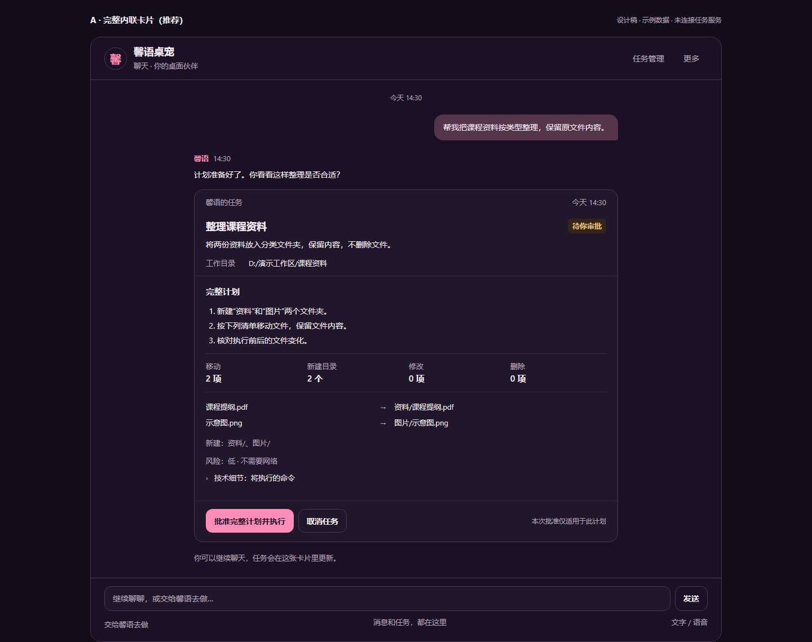
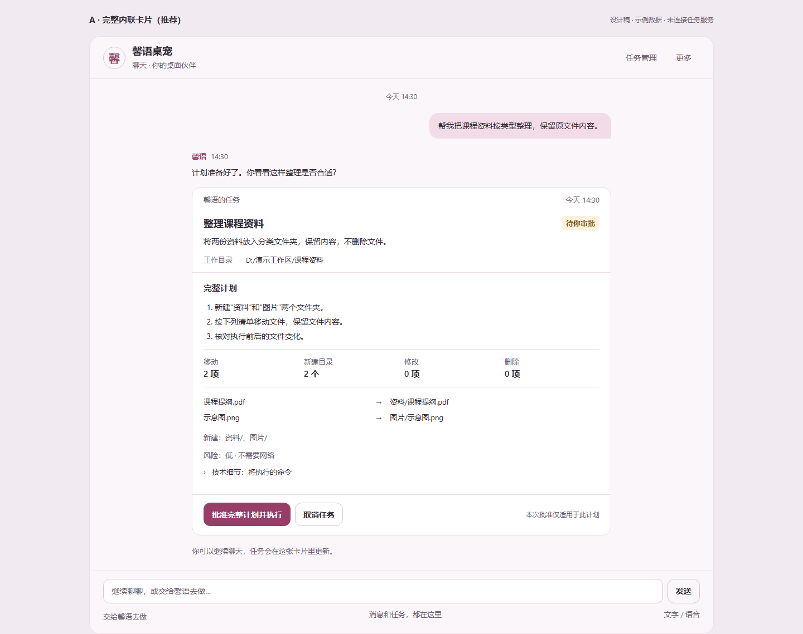

# 聊天中的任务卡片：设计评审

状态：**阶段1，仅调研、静态设计与截图；等待 qinglinMa 确认。** 基于 main `be25324`（已含 #235），分支 `friend/chat-task-cards`。本 PR 没有产品实现；确认方案后才开始阶段2。

目标：用户在聊天里发起任务、查看计划、批准或取消，之后原卡片持续显示进展和结果。保留聊天上下文，不再为了普通任务操作切到工作弹窗。

## 推荐 A：完整内联卡片

任务的目标、目录和状态直接留在聊天流。较宽的聊天区域可原位展开完整计划；小聊天框只保留摘要与“查看完整计划”，审批在**当前窗口的详情面板**中完成，返回后仍是原卡片。

| 深色 | 浅色 |
| --- | --- |
|  |  |

图中是**聊天区域的静态设计**，不是已经实现的桌面应用截图。所有目标、路径、计划和进度均为合成示例，未连接任务服务。完整模型/场景不在这次设计范围；不是把已有 `view=full` 的双消息栏或角色舞台改造成图中的单列布局。

## 三个方案

三者使用同一套任务数据、状态和审批规则，只比较信息的展开方式；不会同时实现三套系统。

| 方案 | 结构与优点 | 代价 | 桌面截图 |
| --- | --- | --- | --- |
| **A 完整内联卡片（推荐）** | 在原卡片展开目标、完整计划、目录、文件清单与审批。最符合“聊天里直接处理任务”，不引入新的常驻工作区。 | 展开计划会占用聊天纵向空间；窄卡片需要同窗口详情面板。 | [深色](screenshots/a-dark-desktop.png) / [浅色](screenshots/a-light-desktop.png) |
| B 紧凑任务条 | 日常只显示标题、目标、目录、状态和简短摘要；用户需要时原位展开计划。适合任务较多、以聊天为主的场景。 | 审批前多一次展开，计划存在感弱于A。 | [深色](screenshots/b-dark-desktop.png) / [浅色](screenshots/b-light-desktop.png) |
| C 卡片 + 同窗口详情栏 | 聊天保留摘要卡片，较宽区域右侧查看完整计划并审批。长文件清单较容易阅读。 | 占用横向空间，可能挤压既有聊天区域；改动范围最大，不作为默认。 | [深色](screenshots/c-dark-desktop.png) / [浅色](screenshots/c-light-desktop.png) |

截图中的A已展开计划；B为收起态；C为详情栏打开态。图中的目录仅是演示文字，不代表项目已授权这个目录。实际界面只能选现有接口返回的 `allowed_roots`。

## 一张卡片包含什么

| 部分 | 内容与来源 | 显示规则 |
| --- | --- | --- |
| 标题 | 从 `goal_summary` 派生的简短任务名 | 不要求新增后端 title 字段；完整目标摘要可展开 |
| 目标 | 当前输入，以及服务返回的 `goal_summary` | 不把截短摘要说成完整原始目标；服务只返回前160字符摘要 |
| 工作目录 | `task.workdir` | 摘要可折行；审批时完整展示，不用省略号遮住授权范围 |
| 状态 | 后端七种状态，另有本地请求提示 | 中文文字与颜色一起表达，不靠颜色区分 |
| 进度 | `progress_count`、`warning_count`、状态与最近成功刷新时间 | 例如“已收到3条进度更新”；**不显示虚构百分比、完成步骤数、预计剩余时间** |
| 计划 | summary、steps、文件创建/修改/删除、planned_moves、risk、needs_network、commands | 审批仍覆盖整份原计划；技术命令可展开查看，删除/高风险/联网提醒不能藏在“更多”里 |
| 操作 | 生成计划、查看计划、批准完整计划并执行、取消、重新规划 | 不把“发送聊天”变成自动批准；重新规划产生新任务，不能重新批准旧计划 |
| 结果摘要 | changes、verification_error、error、warnings | 区分“执行已结束”和“已核验一致”，失败/取消也保留已发生的变更 |
| 详情 | 完整计划、实际核对、未观察到项、计划外项、错误 | 独立展开状态，轮询不能把用户正在读的详情折回去 |

移动按 `planned_moves` / `changes.moved` 单列：同一次移动不能再在“新增/删除”里重复计数。示例计划明确新建两个目录，所以图中写“新建目录2个”；实际组件的通用文案应是“新增N项”，不能把没有类型字段的files_to_create一概说成目录。示例为移动2项、新增2项、修改0项、删除0项。

## 卡片何时出现、如何更新

1. 用户点击现有“交给馨语去做”，或输入现有委派前缀时，在聊天里展开**生成计划表单**，填入目标并选择已授权目录。保持当前语义：此时不调用创建/审批接口。
2. 用户点“生成计划（不执行）”后，才调用既有 POST `/api/agent/task`。请求期间同一个临时位置显示“正在提交”；服务返回 `task.id` 后，就把这个位置变为正式卡片，并以返回的真实状态渲染。规划线程可能已推进，不能硬插一个旧planning状态。
3. 后续以 `Map<task.id, cardNode>` 更新原节点：规划 → 待审批 → 执行 → 终态。轮询与审批响应只更新这一张，不追加“正在运行/已完成”消息气泡刷屏。
4. 普通聊天继续使用现有发送路径。任务卡片和控制消息不作为新的 assistant/user 对话记录写入 LLM history、翻译、TTS 或记忆；已有任务阶段播报若保留，只由当前 narrator 发出一次，不因卡片重绘再播。
5. 多入口指向同一个任务状态源：聊天卡片、原任务弹窗不会各自启动一套轮询或持有两份审批状态。每秒只轮询非终态任务，动作请求与轮询互斥/失效旧响应。
6. 用户在读旧消息时不强制拉到底；靠近底部才跟随。详情的展开、焦点、滚动和文字选择在更新时保持。状态变化用 `aria-live=polite` 简短播报，不逐秒朗读进度数字。

刷新时可从现有任务列表按 `created_at` 重新放回对话中的位置。当前服务最多保留100项任务，服务重启后不保留；**这次不新增持久任务历史接口**。详细恢复/清空行为见[技术调研](research.md#历史刷新与失联)。

## 状态设计

| 服务状态/条件 | 卡片文字 | 可用操作 |
| --- | --- | --- |
| 创建前（本地表单） | 待生成计划 | 选目录、生成计划、收起表单；不展示“批准” |
| `planning` | 正在规划 | 取消任务；不批准 |
| `awaiting_approval` | 待你审批 | 查看完整计划；计划可见时批准完整计划并执行；取消任务 |
| `executing` | 运行中 | 查看已批准计划、取消任务；不重复批准 |
| `cancel_requested=true` 且非终态 | 正在取消 | 取消按钮禁用，等待服务确认停止；不假装已经取消 |
| `completed` | 已结束 | 看结果/核对详情；仅在核对结果正常时写“未发现计划外变更” |
| `failed` | 未完成 | 错误和已有变更；显式重新规划，不自动重试执行 |
| `cancelled` | 已取消 | 查看已发生变更；明确取消不会回滚文件 |
| `expired` | 计划已过期 | 重新规划；禁用旧计划批准 |
| 401 / 403 / 网络失败 / 404 | 原状态 + 局部错误提示 | 不伪造失败终态、不自动提交审批；刷新确认后再操作 |

完整静态状态图：[浅色](screenshots/state-reference-light.png) / [深色](screenshots/state-reference-dark.png)。这些是**同一任务在不同时刻**的参考，不会同时插入聊天流。

## 原工作界面如何处理

**保留原任务弹窗，默认收起。** 当前仓库没有独立的“工作 BrowserWindow”：任务页是控制中心中的 `external-agent-modal`。不改 Electron 的窗口创建、模型窗口或房间。

- 聊天是日常任务操作入口，发起任务后不再自动切到控制中心。
- 原“交给馨语去做”入口在选定设计中转为聊天内表单；“任务管理/更多”可打开原弹窗，查看同一任务的完整信息及兼容旧习惯。
- 弹窗、卡片复用同一 controller/store/命令入口和 narrator；关闭弹窗只是关闭视图，不是取消任务。
- 控制中心原有导航/功能保留；不在这次删除旧页或修改外部 agent 的权限逻辑。

## 窄聊天区域

布局按**卡片容器可用宽度**判断，不只按 OS 窗口宽度。当前 Electron 聊天窗口最小760×560，但全景双消息栏中的卡片可能很窄；旧 `view=chat`、浏览器嵌入也可能只有360像素。本 PR 不降低 Electron 最小尺寸。

- 卡片约480像素以下：标题、目标、完整可换行目录、状态与关键摘要优先；单列，不横向滚动，按钮至少44像素高。
- 审批从“查看完整计划”进入**同一个窗口内的详情面板**，不是新窗口、不是新后端入口。顶部“返回聊天”，中间滚动完整计划，底部留位放批准/取消，不能遮住最后一行文件或错误提示。
- C 的右栏在窄区域退化为同一详情面板；不会把聊天压成两条无法阅读的竖列。
- 动作提交时，同一任务所有视图按钮同步禁用；失败恢复按钮并显示原因，不能因为卡片太小而省掉审批说明。

| 方案 | 深色窄卡 | 浅色窄卡 |
| --- | --- | --- |
| A | [查看](screenshots/a-dark-narrow.png) | [查看](screenshots/a-light-narrow.png) |
| B | [查看](screenshots/b-dark-narrow.png) | [查看](screenshots/b-light-narrow.png) |
| C | [查看](screenshots/c-dark-narrow.png) | [查看](screenshots/c-light-narrow.png) |

窄区域审批详情：[深色](screenshots/approval-sheet-dark.png) / [浅色](screenshots/approval-sheet-light.png)。

## 深浅色与现有风格

保留 Segoe UI / Microsoft YaHei UI、樱花色点缀、圆角和消息气泡。深色取现有 `tokens.css` 的夜色与粉色，任务信息保持实色表面；浅色是同一组件层级的对照设计，不引入新品牌或素材。

当前最终样式层 `tokens.css` / `visualPolish.css` 基本固定为深色；场景的白天/夜晚切换**不是可靠的聊天浅深色切换接口**。浅色截图是提案，不代表现有产品已经能完整切换浅色。阶段2需作者确认聊天局部主题如何接入；不顺手重做房间、全局主题或渲染器。若希望新增全局主题开关，应另确认范围。

## 请作者确认后再实施

| 决策 | 建议 |
| --- | --- |
| 主方案 | A：宽卡片内联展开，窄卡片使用同窗口详情 |
| 原工作页 | 保留为收起的详细管理/兼容入口，和卡片共用状态源 |
| 小聊天框审批 | 同窗口详情面板、完整目录/计划与44px按钮 |
| 浅色接入范围 | 确认聊天局部主题来源；本设计不包含全局主题或场景改造 |

现有接口足够完成这里的最小方案，**无后端接口改动需求**。如果后续要求持久任务历史、真实百分比、逐步骤进度或新的审批方式，先停下问 qinglinMa，不在前端伪造这些能力。

## 验证与后续交付

本阶段只检查静态设计：3方案×2主题×桌面/窄屏共12张，加2张窄屏审批、2张状态参考；另外检查320/360/760像素和长路径不横溢。截图浏览器无外网/任务接口请求，无音频。已有 external-agent 前端回归通过；产品源文件、权限代码和测试基线未改。详细视觉核对见[视觉复核](visual-review.md)。

阶段2（确认后）再做真实卡片状态/去重、鉴权失败、窄屏布局测试，并录制“发起 → 审批 → 进度 → 结束”的深浅色各一段**真实流程录像**。本阶段没有功能录像，静态图不能当作功能已实现。文件与引用梳理、实现边界和验收矩阵见[技术调研与实施方案](research.md)。
