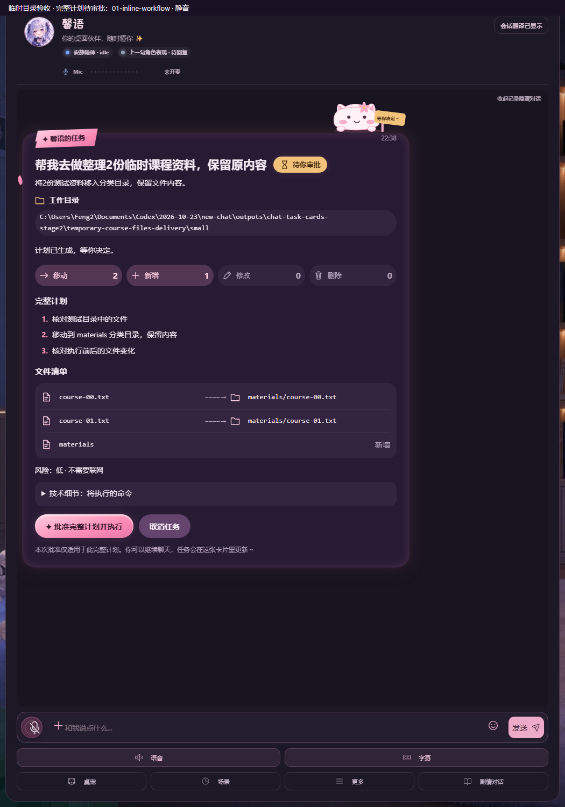
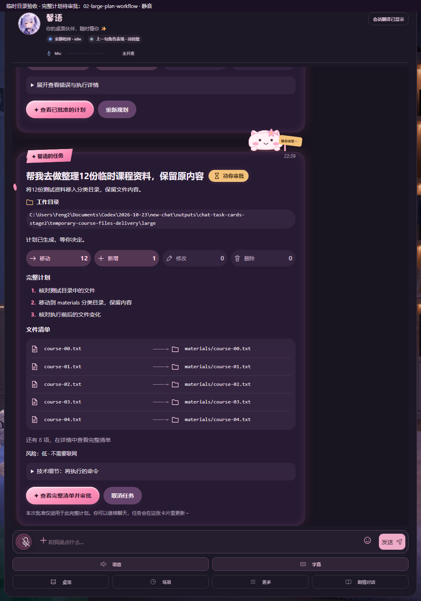
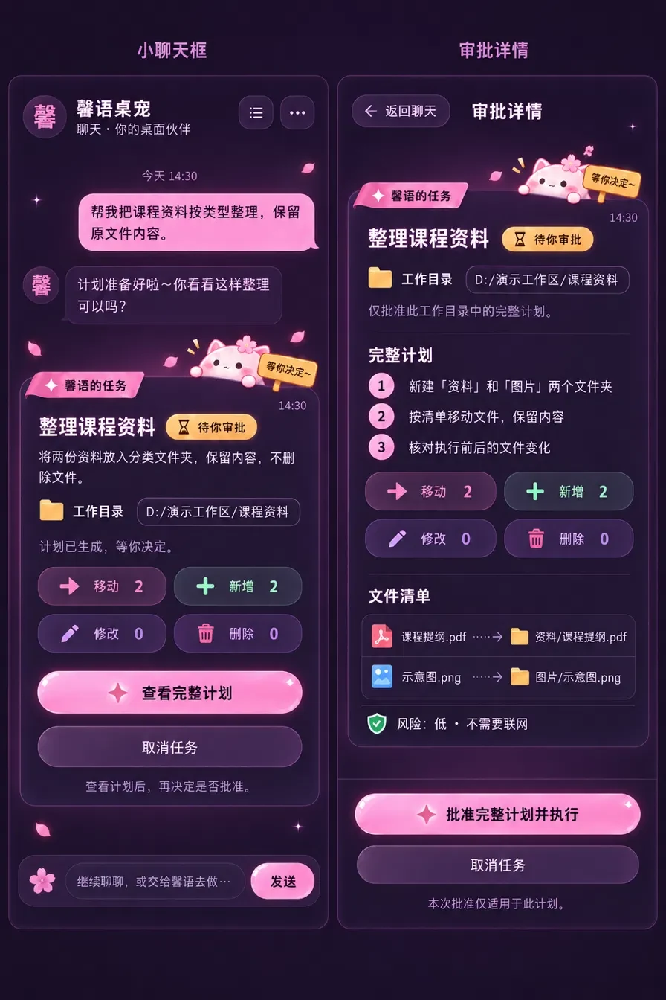
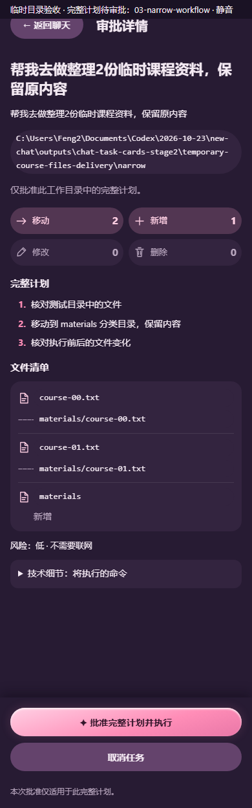
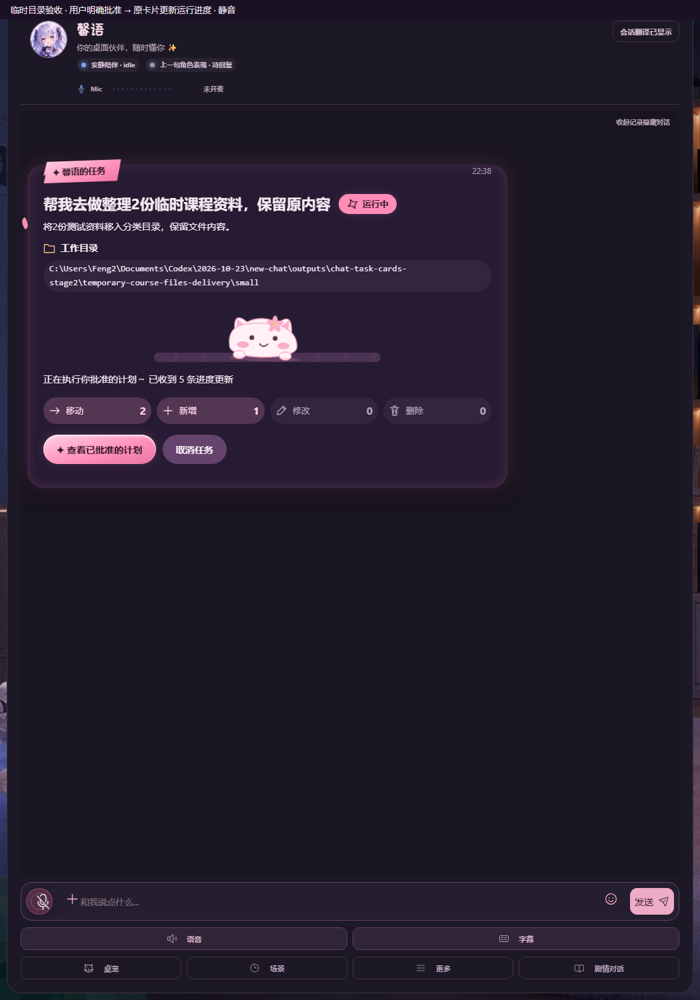
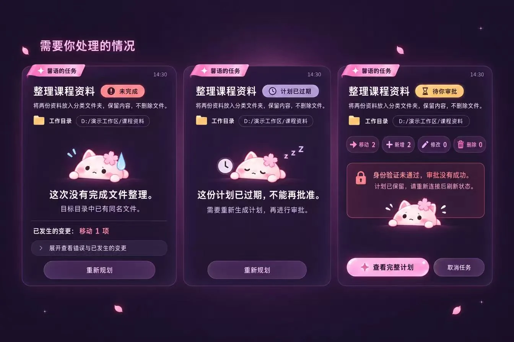
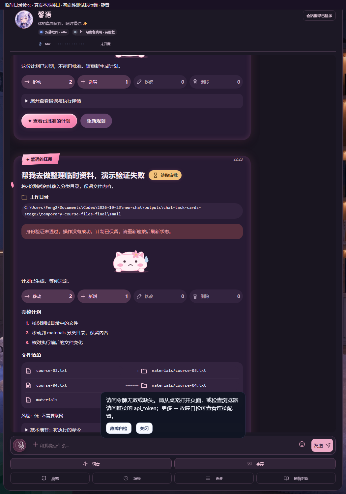

# 聊天任务卡片：阶段2实现与验收

日期：2026-10-29；分支 `friend/chat-task-cards`，PR #237。作者确认方案A、只做深色、原任务弹窗保留；用户确认只有5张参考图，按这5张覆盖的状态完成对照。

聊天委派现在先在聊天里填写目标、选择已有授权目录，再显式生成计划。服务返回任务ID后显示一张任务卡片，后续规划、审批、进度和结果更新原卡片。普通聊天、现有模型/背景/房间、后端执行和权限逻辑没有改动。

## 实现与文件

| 文件 | 改动 |
| --- | --- |
| `web/taskCardModel.js` | 七状态、取消中、未知状态只读、移动去重、计划/实际计数和局部错误文案 |
| `web/taskCardMascot.js` | 原创SVG樱花团子及表情/道具、通用文件/状态图标；不取设计图像素 |
| `web/taskCardView.js` | 唯一task.id节点、完整内联计划、表单、同窗口详情、焦点与文字选择保留、大小/视口/可见性监听 |
| `web/taskCards.css` / `web/tokens.css` | 不透明深色表面、24px圆角、缎带、状态与计数胶囊、警示、印章、轻动画；颜色均来自token |
| `web/externalAgentController.js` | 同一个Map/store、请求忙态、1秒单飞轮询和narrator；操作epoch使旧GET失效；静默列表恢复 |
| `web/chat.js` / `web/chatMessageController.js` | 重绘后的任务节点重挂；task记录不进入普通对话历史/翻译/TTS；无新的模型意图识别或后端路由 |
| `web/index.html` | 加载新前端模块与样式；不改Electron窗口 |
| `tests/test_task_cards.js` / `docs/tests/task-cards.spec.ts` | 状态/数据/控制器回归与真实Chromium组件测试；已接入现有Linux/Windows测试入口 |

共享前端的接线仅限聊天重绘回调和索引脚本加载。`apiClient.js`、所有Python后端、外部agent权限逻辑、Origin校验、VRM/Live2D渲染器、房间、brain、执行器和Electron窗口代码均未修改。所有任务请求仍调用原有 `authFetch` 和 `/api/agent/task` 系列接口；没有新增请求头、token来源、权限或旁路。

## 审批、状态和数据真实性

- 卡片按实际宽度约480px切换。窄卡片不放批准按钮，同窗口详情完整展示计划并审批。文件清单按移动去重后**合计超过10项**时，宽窄卡片都只预览前5项及剩余数量；主按钮是“查看完整清单并审批”，卡片DOM里没有批准按钮。原管理弹窗遇到大清单也转入同一详情审批。
- 10项以内的宽卡显示完整计划和内联批准；风险、需要联网、实际删除、服务错误和身份错误始终在卡片可见区域，不能折叠藏起。删除为0时使用中性淡粉紫；薄荷绿只用于已结束状态。
- 移动从新增/删除中扣除，路径只在小胶囊内用系统等宽字体；文件类型图标全部通用自绘。任务进度只写“已收到N条进度更新”，没有填充比例或虚构百分比。
- 取消请求与终态分开：正在取消时禁用取消按钮，直到服务确认停止；已发生的变更不会假装回滚。核验错误、计划外项和未观察到项会提示“需核对”，不盖无异常完成印章。
- 卡片不是普通消息记录，不进入LLM history、翻译、TTS或记忆。保留原narrator的一次阶段播报；初次任务列表hydrate仅prime，不重播旧任务。辅助技术只播报阶段变化，不每秒朗读进度数字。
- 一个task.id对应一个节点；重绘和分栏重挂仍复用原节点。进度更新不替换完整计划DOM，保留展开、焦点和路径选择；不把卡片状态作为新消息刷屏。靠近聊天底部时才跟随更新。
- 动作请求与轮询共用忙态。动作开始就失效之前的GET，旧响应不能把执行中恢复成待审批。401/403/404/409、非JSON或网络错误保留快照和计划，不自动重试create/approve。原 `authFetch` 的既有401刷新策略未改变。
- 当前服务仍只有最多100条内存任务，重启后不保留；不新增持久历史或逐步骤进度。清空/重绘普通消息不发送取消，任务仍可通过原任务入口找回。

## 视觉与动画

樱花团子是根据本任务文字描述另画的SVG：圆团、小猫耳、樱花、点眼和腮红，共用轮廓，审批举牌、删除汗滴、原地小跑、取消停止牌、结束撒花、失败冒汗、过期打瞌睡和身份错误担心等变体。插图区92px；审批时在卡片右上沿探头，时间和状态不被遮住。

运行轨道的花纹以独立伪元素位移，团子保持在中央，只有轻微原地跳步，不沿轨道前进；无进度填充。动画只在卡片非终态、进入视口、文档可见且系统未开启reduced-motion时创建。离屏、隐藏、终态及reduced-motion下均无卡片动画对象；没有新增RAF或轮询计时器。轨道和整体SVG使用合成位移，避免逐帧改变背景位置或SVG内部路径。

沿用阶段1的深色方向（true-black-flat，seed1257220883，保留项目色彩/字体），实际视觉以作者确认图为准。设计技能默认会拒绝星形符号、渐变按钮、发光与路径等宽字体；这些分别对应用户明确要求的缎带/星星、光泽按钮、柔和发光和路径胶囊，故保留。源码lint的这些提示未伪称为零；浏览器复核以 `emoji,button-fx,gradient` 三项有理由例外检查，其余布局/对比度/触达规则照常检查。

## 作者参考与实际应用对照

左列均为**AI生成，仅作设计参考，不是产品素材**；权利归qinglinMa，用户授权加入文档，只做WebP转换。右列来自实际 `web/index.html?view=chat`，未改现有背景。顶部“临时目录验收”是验收标注，不是新增产品功能。

| 作者确认参考 | 实际应用 |
| --- | --- |
|  |  |
|  | ；[完整清单详情](actual/02-large-plan-workflow-details.png) |
|  | ；[窄聊天卡片](actual/03-narrow-workflow-approval.png) |
|  | ；[正在取消](actual/04-cancel-pending.png) / [已结束盖章](actual/01-inline-workflow-completed.png) |
|  | ；[未完成](actual/05-failed.png) / [计划过期](actual/05-expired.png) |

实际工作目录较长，因此会换行。计划与数字来自当次任务，不照抄图中的演示数量：普通/窄屏各移动2个测试文件、大清单移动12个；每次新建1个分类目录。全部终态文件核对无计划外项、无计划未观察到项。

## 流程录像与验收边界

三段MP4均静音、无加速，已经完整解码校验。录像留在Git之外，上传到仓库既有的**验收资料草稿附件**，需有仓库写权限的账号登录；未发布Release。用户另有可转发ZIP。

| 录像 | 内容 |
| --- | --- |
| [普通计划流程](https://github.com/MaQinglin-665/AI-chat/releases/download/untagged-d2ff791d304d9886571a/chat-task-cards-pr237-20261029-01-inline.mp4) | 聊天发起→选已有授权目录→生成→待审批→内联批准→进度→结束盖章 |
| [大清单详情审批](https://github.com/MaQinglin-665/AI-chat/releases/download/untagged-d2ff791d304d9886571a/chat-task-cards-pr237-20261029-02-large-plan.mp4) | 12个文件移动加1个新增目录，卡片预览5项，完整详情才批准→进度→结束 |
| [390px窄聊天框](https://github.com/MaQinglin-665/AI-chat/releases/download/untagged-d2ff791d304d9886571a/chat-task-cards-pr237-20261029-03-narrow.mp4) | 当前窗口完整详情审批→返回聊天看进度→结束 |

**这些是实际应用前端、原有HTTP鉴权/Origin/路由、ExternalAgentManager、审批审计和文件清单核对的集成流程；执行端使用隔离的确定性临时文件测试适配器，没有调用LLM或Codex CLI。** 真正发生了测试文件移动，原内容保持，范围只限自建目录。测试启动器与适配器只在本地输出/辅助目录，不进产品、无新测试后门或后端路由。

失败由测试适配器在移动1项后报告同名目标错误，取消中等待清理确认，过期使用测试时钟推进，身份失败使用本测试服务的错误token。身份错误后保留原计划，实际401仍由原鉴权返回；原全局状态提示也会出现，可按已有关闭按钮收起。

本机可找到的CLI为0.163，低于项目要求0.164，当前进程无DeepSeek测试凭据；未读取私人配置寻找Key。**用户已确认先交付，原生Codex/DeepSeek端到端验收由作者电脑补做。** 这些录像不冒充真实模型生成/执行成功的证明。

## CPU测量

在独立Chromium实例、1050×1500实际聊天页面、同一运行中任务、相同1秒轮询、无录屏条件下，记录该浏览器及其子进程CPU秒数。单核100%口径，3组成对8秒样本；全局motion始终保持no-preference，对照只给 `.task-card` 子树禁用动画。

| 样本 | 卡片动画关 | 卡片动画开 |
| --- | ---: | ---: |
| 1 | 104.52% | 102.42% |
| 2 | 102.75% | 103.07% |
| 3 | 102.56% | 102.81% |
| 中位数 | 102.75% | 102.81% |

中位数相差约 **+0.06个百分点**，处于这组短测的噪声范围，不能据此声称所有机器零开销。环境是ANGLE/SwiftShader软件渲染；既有stage-room-drift、scene-light-breathe、scene-motes-drift、scene-halo-breathe、scene-floor-breathe仍运行，基础CPU较高。本任务未改这些原有场景效果，数据也不是全机CPU或GPU占用。

初次用全局reduced-motion对照会同时关掉原有动画，造成约13%与103%的混合差异，**已排除，未把它当卡片开销或优化收益**。源码已将轨道改为合成位移，但没有伪造优化前后的卡片CPU收益。Windows Electron硬件渲染表现仍由作者实际验收。

## 自动化验证

- 完整 `scripts/test-local.ps1`：1105 Python通过、3跳过；原有与新增Node测试通过。最后前端调整后再跑 `-SkipPytest`：86个Node测试文件、199 Python语法、271 JS语法、敏感信息与本机Hiyori/Mao引用检查通过。Python产品/测试未改，未重复无关Python门禁。
- 新Node测试：七状态/取消中/未知/缺计划、移动去重与真实计数、100次poll唯一任务、静默恢复、401/403/404/409/5xx/非JSON/网络、忙态、旧GET与动作竞争、未授权目录拒绝、任务记录隔离。原external-agent前端测试仍通过。
- 7项Chromium组件测试：唯一节点、展开/焦点/文字选择、XSS文本、清单阈值与DOM无批准按钮、完整详情、390px长路径、忙态/身份错误保留计划、所有状态直接警示、删除0颜色、reduced-motion/离屏/终态无动画、分栏重挂。随原docs smoke在Linux/Windows CI运行。
- 实际页面流程：三段全部完成，分别移动2/12/2份临时文件；核对无计划外或未观察到项；各ID仅一张卡。失败/取消/过期/401截图另行核对，无页面脚本异常。所有媒体解码、公开JSON、必需py_compile、first-run package与最新head CI结果以PR说明和Checks为准。

## 已知限制与作者接手

只做深色。现有后台任务保留策略和原全局鉴权提示保持；不新增持久任务历史、逐步骤百分比或聊天清空API。首次运行引导可按原按钮关闭。任务页面只处理已显式委派的有限前缀，没有新增大模型意图识别。服务缺配置/禁用时显示局部提示，不自动授权目录或启用功能。

请作者在Windows实际使用并补原生CLI/DeepSeek任务后决定合并；本任务不直接push main、不force push、不自行合并。模型、Key、私人配置、日志、临时文件和录像均不进Git。
