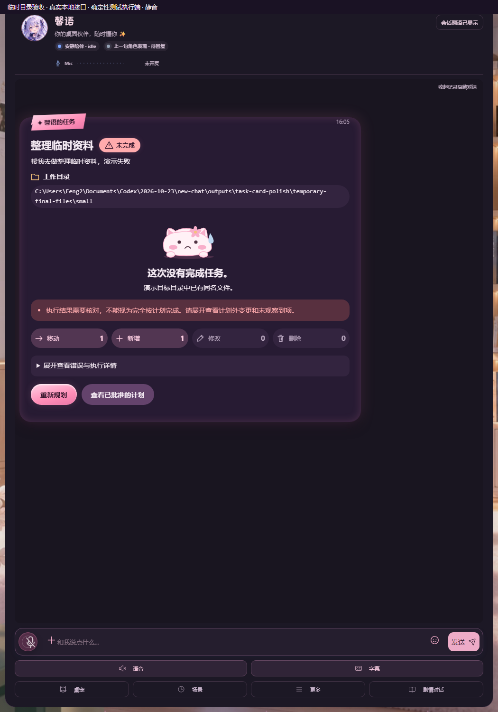
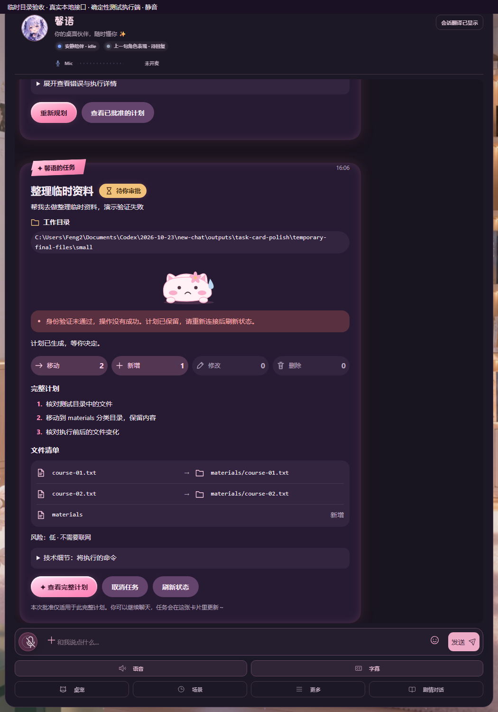

# 任务卡片两处提示小修

分支friend/task-card-polish，基于main40c4d4c（已合并#237）。

失败原因已经显示在粗体结论下时，从错误框去掉同一条原因，末尾标点差异也视为同一句；原错误若有后续说明，仅保留后续内容。其他错误、核对警告不丢失。详情没有该原因句，因此仍保留完整错误。

已存在卡片的任务读取/批准/取消请求，把鉴权错误的显示位置指定为inline，交由原controller/view渲染。apiClient新增第三个仅供显示层的选项，聊天薄包装原样转发；不传到原生fetch，不改authFetchImpl、令牌来源/刷新、401重试、鉴权头、Origin或服务端行为。启动任务列表失败且没有卡片、旧管理界面及其他调用仍保留全局提示；500/网络故障原提示保留。

## 实际页面

两张均为静音隔离临时目录测试，实际web/index和原鉴权/任务管理器；确定性本地执行适配器，不是原生CLI/LLM证明。失败移动1项后返回测试错误，401用该测试服务的错误token，未访问个人目录/Key。

| 失败：原因一次，其他核对提示保留 | 鉴权：保留卡片计划，无全局提示遮挡 |
| --- | --- |
|  |  |

## 验证

Node覆盖原因之外的显示规则、局部/全局选择、同令牌不重试POST、鉴权头与其他页面全局提示、500提示不被隐藏，以及chat两层包装转发。17项Chromium检查（原15+2），真实页面另外确认401时全局提示隐藏、无脚本错误、卡片保留。

完整本地门禁的Python1105通过/3跳过；最终前端/语法/敏感扫描结果和最新提交Linux/Windows CI见PR说明。Windows编辑曾改变chat换行，源码断言因此失败，已恢复LF后重跑，不修改断言或行为基线。没有后端、权限、模型、渲染器或依赖更改；不自行合并。
