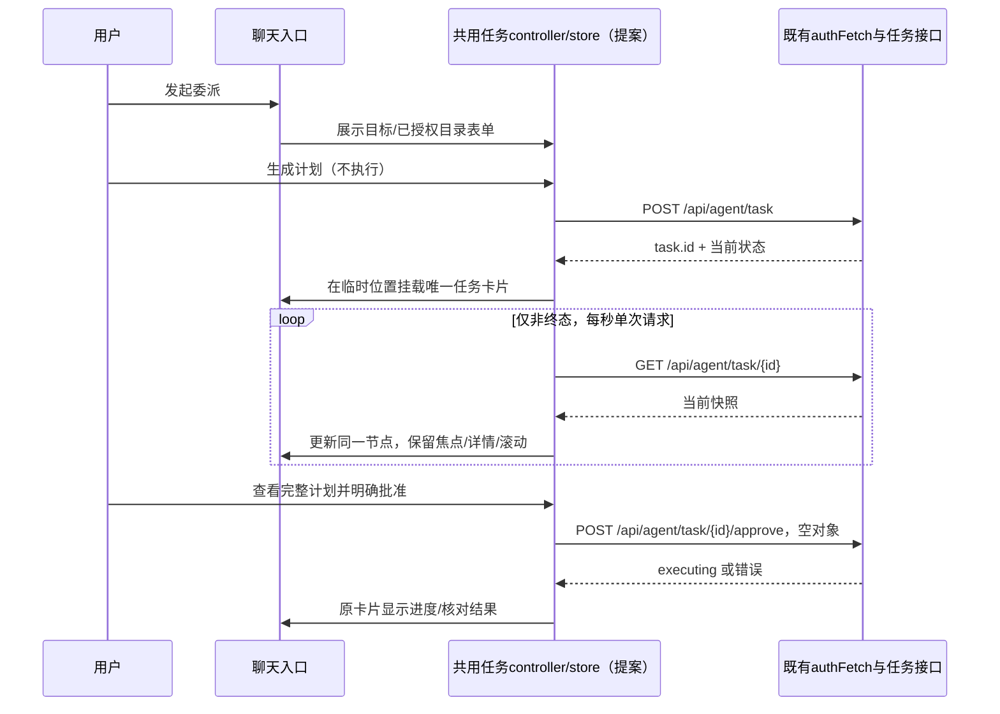

# 聊天任务卡片：现状、接口与实施边界

调研基线 main `be25324`，日期2026-10-29。以下路径均为公开源码；未启动真实服务、未读取私人配置/历史/Key、未创建或审批实际 agent 任务。本文件是实现建议，不是已存在的卡片API。

## 现有前端与数据流

| 位置 | 当前职责 | 卡片阶段2的接入点 |
| --- | --- | --- |
| [web/chat.js](../../web/chat.js) 的 sendChat / 初始化 | `offerDelegation` 匹配后清空输入；当前只是 open 表单，未创建任务。注入 authFetch/state/speak/emotion。 | 保留原委派识别范围和普通聊天链路；将表单显示位置转入聊天，不自动执行 |
| [externalAgentController.js](../../web/externalAgentController.js) | 私有单 task、requestBusy、polling、JSON渲染签名；按钮/API封装；1秒轮询非终态，弹窗隐藏也会继续；narrator每task/status最多一次 | 在同一个状态源上增加订阅/视图挂载，旧弹窗和卡片共用动作入口；不额外创建第二套轮询/narrator |
| [index.html](../../web/index.html) / [controlCenterShell.js](../../web/controlCenterShell.js) / [externalAgent.css](../../web/externalAgent.css) | `external-agent-modal`、完整计划/目录/审批/取消及控制中心导航 | 原弹窗保留为详细管理与兼容入口；窄屏审批可复用其同窗口容器并增加局部审核模式 |
| [chatMessageController.js](../../web/chatMessageController.js) | 文本/贴纸记录、分栏、重绘、翻译、反馈、历史同步；当前同步仅排除 sticker，不认识 task 类型 | **不能简单把卡片当普通assistant文本append**；用专门任务视图，排除LLM history/翻译/TTS/记忆，重绘时恢复任务锚点 |
| [chatDom.js](../../web/chatDom.js)、[chatPolish.css](../../web/chatPolish.css)、[experienceFixes.css](../../web/experienceFixes.css) | `view=full` 对 user/assistant 分栏，`view=chat` 统一chatLog；全景窄栏与滚动约束 | full 卡片进入 assistant lane，chat 进入统一 lane，原 message-lane 路由保持；按卡片宽度而非整窗判断紧凑模式 |
| [toolMetaView.js](../../web/toolMetaView.js) | 已显式忽略 external_agent_task 的通用审批卡 | 保留忽略，不能让通用确认入口和新任务卡重复审批 |
| [apiClient.js](../../web/apiClient.js) | authFetch读取现有token来源，带X-Taffy-Token；401且token刷新成功时仅沿用现有的一次重试 | 所有GET/POST均调用它；不改token来源、不拼Origin、不写新直连fetch或Electron旁路 |
| [electron/main.js](../../electron/main.js) | modelWindow/chatWindow；聊天默认加载 view=full，最小760×560 | 本次不改窗口创建、大小限制或IPC；“工作页”并非额外BrowserWindow |

当前委派前缀是 `isDelegation` 的有限正则：例如“帮我去做…”、“交给馨语去做…”、“帮我把…整理”。不把一般“你觉得怎么整理”变成执行任务，不新增大模型意图识别或自动授权。

旧弹窗与新卡片只订阅同一个store；图中没有新的后端API、WS协议或批准入口。

## 已有HTTP契约

来源：[app_external_agent.py](../../app_external_agent.py)、[external_agent.py](../../external_agent.py)。

| 方法/路径 | 输入 | 响应与用途 |
| --- | --- | --- |
| GET `/api/agent/task` | 无 | `{ok, allowed_roots, tasks}`；任务列表与当前允许目录 |
| POST `/api/agent/task` | `{goal, workdir}` | HTTP202，`{ok, task}`；生成规划任务，不等于批准执行；按返回快照渲染，线程可能已推进到待审批 |
| GET `/api/agent/task/{id}` | 无 | HTTP200，`{ok, task}`；状态/计划/进度/核对快照 |
| POST `/api/agent/task/{id}/approve` | 当前前端发 `{}` | HTTP202，`{ok, task}`；后端按task.id消费原审批、重检配置/目录/计划 |
| POST `/api/agent/task/{id}/cancel` | 当前前端发 `{}` | HTTP202，`{ok, task}`；请求取消；不承诺已经清理完成或回滚 |

task.id 由服务生成，是32位小写十六进制；按钮只能绑定已得到的任务对象。`confirmation_id` 不是让前端绕到通用工具确认入口的依据；仍只能对当前任务调用其原有approve接口。

服务错误为 `{ok:false, code, error}`；Origin拦截的403仅保证ok/error，不保证code。前端错误处理需保留HTTP status，允许无code/非JSON错误体的通用提示，不能因解析失败丢掉卡片。

## 可显示的任务数据

| 字段 | 当前含义/限制 |
| --- | --- |
| id / status / created_at / updated_at | 标识、七状态、Unix秒时间；`updated_at`主要在状态转移更新，进度事件未必改它 |
| goal_summary / workdir | 目标最多160字符摘要及已验证目录；不是原始完整8000字符goal |
| plan | summary、risk、needs_network、steps、files_to_create/modify/delete、commands；规划完成前为null |
| planned_moves / approval_warnings / expires_at | 移动对照、删除/高风险/联网提醒、计划期限 |
| progress_count / warning_count / warnings | 进度事件数量与有限警告；不包含真实完成百分比、当前步骤索引、逐条stdout或预计完成时间 |
| cancel_requested | 取消请求已发出，后端仍可能在清理；不是独立终态 |
| error / verification_error | 执行/审计/验证失败的可公开说明；不得拿任务完成字样掩盖它们 |
| changes | moved/created/modified/deleted、planned_not_observed、out_of_plan及数量；失败/取消时也可能存在 |

仅使用公开字段；不访问 `_config`、`_goal`、worker、取消事件等服务内部对象。`progress_count` 在规划和执行阶段可能累计，故文案是“已收到N条进度更新”，不称“执行了N步”。

## 状态与取消

正常：`planning → awaiting_approval → executing → completed`。规划/执行可能进入failed；awaiting_approval能直接cancelled或expired。planning/executing收到取消请求后先 `cancel_requested=true`，只有worker清理完成后才终态；cancel_failed可能failed并带verification_error。**不要把HTTP202取消响应直接画成已取消**。

后端一次只允许一个活动任务；已有活动任务时创建返回409 busy。只在终态后允许显式“重新规划”，它会产生新id/新卡片，旧结果仍可查看。审批过期或被另一入口消费时409，不重放旧批准。

completed只表示执行结束。`changes.out_of_plan_count>0`、planned_not_observed非空或verification_error时，在摘要上提示“已结束，需核对”；不能只给绿色“全部成功”。取消/失败若已有变更，也必须展示核对结果，不能暗示已经撤销。

核对沿用当前文件元数据对照，不额外承诺字节内容/diff全部验证。files_to_create只是一组路径，没有通用的文件/目录类型字段；生产卡片用“新增N项”，只有像示例计划这样明确新增目录时才在说明里具体写目录。

## 唯一卡片与响应顺序（实施建议）

- 每个正式task.id只有一个cardNode；提交前的本地表单/请求占位用临时client key，POST成功后原位升级，不能先创建正式卡又保留占位。
- 一个store缓存服务快照，一个轮询器，所有视图通过订阅更新；审批、取消、旧弹窗按钮共享requestBusy，不能双击/跨入口并行重复提交。
- 复用当前1秒单飞轮询。动作开始时暂停该任务轮询并失效旧请求序号，动作响应和只读回查后再恢复；避免旧GET覆盖已执行/取消/终态。
- 去重比较status/progress_count/warning_count/cancel_requested/plan/changes/error等快照内容，不能只比较updated_at。变化时局部补丁更新，而不是replaceChildren整个任务卡片。
- 元素焦点、details展开、滚动锚点和正在选中的文本独立保存；用户不在底部时不自动scrollToBottom。新阶段最多播报一次，不能跟每次poll重说。
- 列表初次恢复只作静默hydrate，不能把最多100个历史快照逐个传给narrator当成新事件；卡片重绘/翻译/详情展开也不触发TTS或表情。只有真实的新任务/后续状态变化沿用现有每阶段一次的播报策略。
- 现有companion事件包含task_id/phase/计数，缺完整计划；一期采用已有轮询即可，不引入新的推送权限或改WS。以后若复用事件，也只作只读刷新提示。

## 历史、刷新与失联

- 任务视图独立于普通聊天记录：不用assistant文本伪装任务，不把计划/命令送入LLM history、翻译或记忆。本方案不新增后端记忆/会话字段。
- 页面重绘/切栏时用store中的task.id重新挂载，不创建第二张卡；页面刷新后用GET任务列表和created_at恢复当前服务保留的任务。服务内存仅保留最多100项，重启就丢失，这不是持久任务历史。
- 本次任务的完整输入只在当前会话可见；刷新后可恢复服务返回的160字符目标摘要与完整plan。若要求更长原目标/跨服务永久回放，需作者另确认后端接口，不在一期补造。
- 清空聊天不等于取消任务，不对任务发送cancel。活动任务仍可从任务入口找回；已收起/清除的终态卡不应被下一次poll重新刷出，可由前端的显示截止时间/已收起id记录控制，不写服务权限或记忆。
- 404时卡片显示“任务当前不可用，可能已随服务重启清除”，不是臆测failed/取消；操作禁用，保留当前只读摘要。列表读不到时不清空已有快照。
- POST响应丢失：保留“状态待确认”，先只读查列表/已知id，不能自动再发一次create/approve；409 busy时关联当前活动任务，不反复创建。

## 鉴权与错误提示

来源：[apiClient.js](../../web/apiClient.js)、[app.py](../../app.py) `_do_POST`、[app_get_routes.py](../../app_get_routes.py)。GET/POST都先走现有Origin和token校验，再dispatch任务；manager仍检查enabled、目录、计划和原审批。

| 情况 | 卡片反馈/行为 |
| --- | --- |
| 401，authFetch现有刷新仍失败 | 保留任务与计划；“身份验证未通过，操作未成功，请重新连接后刷新状态”；不变更任务状态、不自造token/匿名请求 |
| 403 Origin不允许 | “请求来源校验未通过，操作未成功”；不建议关闭Origin检查，不设置伪造Origin、不换新端口/代理绕过 |
| 403 disabled / 无allowed_roots | 显示现有功能未启用/没有已授权目录，禁用生成计划；引导现有设置，绝不自动开启功能或扩充目录 |
| 409 busy / not_awaiting_approval / approval_missing | 只读刷新当前任务；显示冲突原因，旧批准不可重试，重新规划必须用户再发起 |
| 404 / 网络 / 5xx / 响应无法解析 | 原快照 + 局部错误/上次成功更新时间；“刷新状态”只GET，不把连接失败伪装成任务失败 |
| 已提交取消但未终态 | 按钮显示“正在取消…”并禁用，轮询继续直到服务终态，不声称文件已回滚 |

所有按钮仍调用注入的authFetch和已有接口。渲染goal、path、commands、error、文件名全部使用textContent，不能把外部agent输出当HTML执行，也不增加shell/文件访问IPC。

## 阶段2建议文件范围

只考虑web前端：externalAgentController/对应CSS、新任务卡视图模块（如taskCardView.js）、chat.js薄接线、chatMessageController/聊天重绘边界、必要的index脚本加载与chat样式；增加对应前端测试。名字为建议，尚未创建这些模块。

不改VRM/Live2D/房间、后端brain/执行器、external_agent.py、app_external_agent.py、权限/鉴权/Origin规则或electron窗口创建。若分析后确认需后端接口，先停下问qinglinMa。不要借新卡片把任务外部执行和普通聊天默认混为自动执行。

## 阶段2验收矩阵（本阶段不声称通过）

| 组别 | 要验证的行为 |
| --- | --- |
| 生命周期 | 创建占位→planning→awaiting_approval→executing→completed；failed/cancelled/expired与cancel_requested独立覆盖；终态仍能展开核对 |
| 唯一与顺序 | 同id百次轮询仍仅一张；动作响应优先于旧GET；弹窗/卡片共用状态；重绘、切栏、刷新、清空聊天、409 busy无重复 |
| 审批 | 看得到完整目标摘要、目录、文件清单、风险/网络/删除、commands；只对当前task.id调用原approve；跨入口按钮忙态同步 |
| 鉴权失败 | 401刷新失败、Origin403、disabled403、无目录、404、网络/5xx、非JSON；保留计划、提示正确，不发生额外POST或绕行 |
| 结果真实性 | 移动不双算新增/删除；计划外、未观察到、核对失败醒目；取消/失败不冒充回滚或全部成功 |
| 数据隔离 | 卡片/命令不进入普通聊天history/翻译/TTS/记忆；原narrator每阶段一次；恶意goal/文件名/错误只显示文本 |
| 恢复安全 | 初次列表hydrate不重播旧任务；未知状态/缺计划保持只读，不展示可批准按钮；过期以服务回查为准 |
| 布局/可访问性 | 两种theme、320/360/390px卡宽、760px窗、1440px视图、超长路径/命令、键盘/焦点、44px按钮、不横溢、不抢滚动 |
| 真实录像 | 深浅色各一段：从聊天明确发起→选目录生成计划→卡片待批→批准→真实进度→结束核对；启动任何语音前先告知使用者 |

阶段1只交付本设计文档与静态截图，Draft PR后停止；作者确认前不写实现或录制冒充真实流程的演示。
