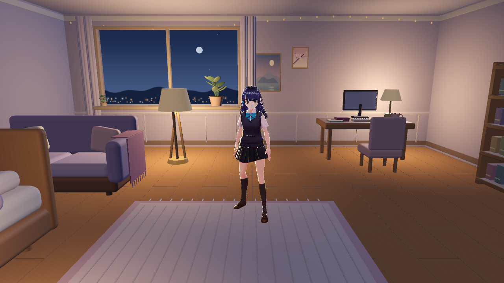
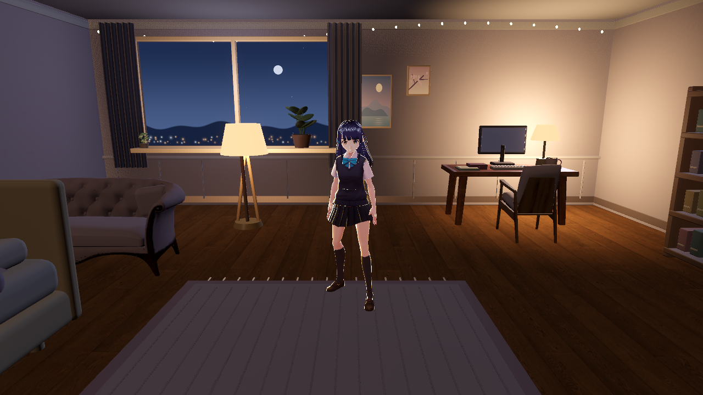
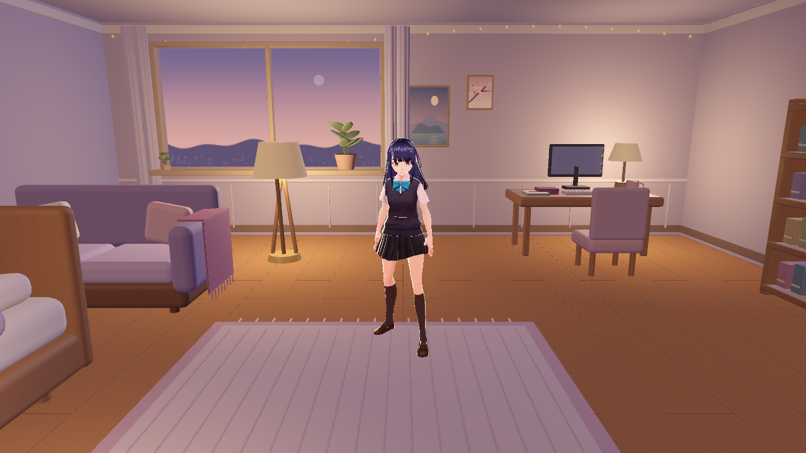
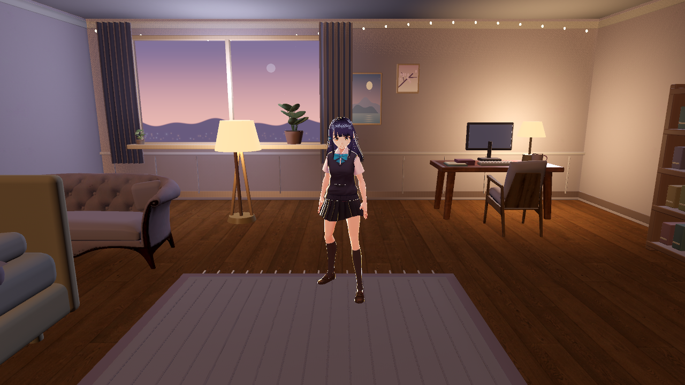
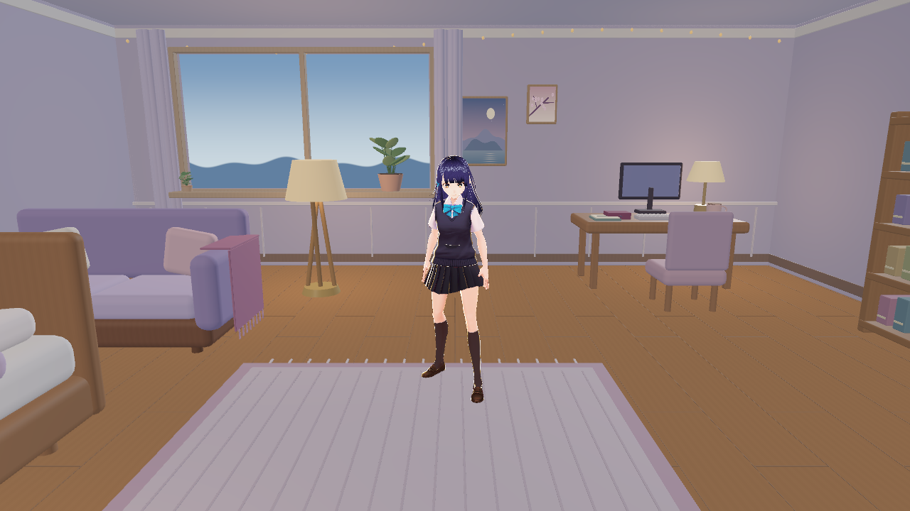
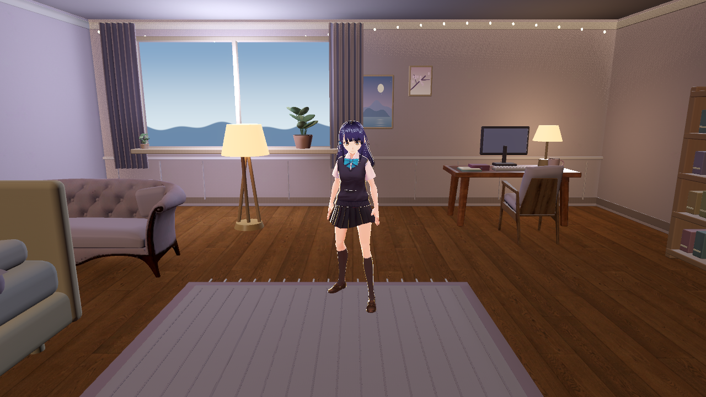
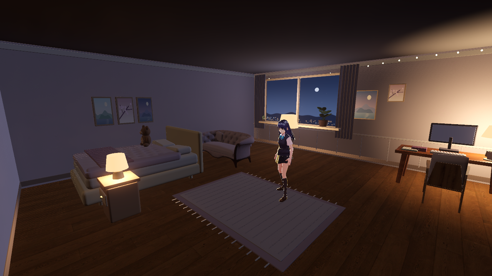
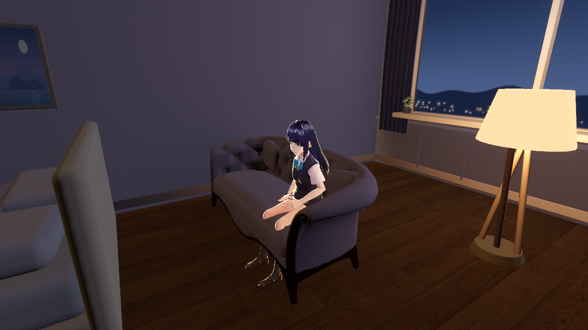
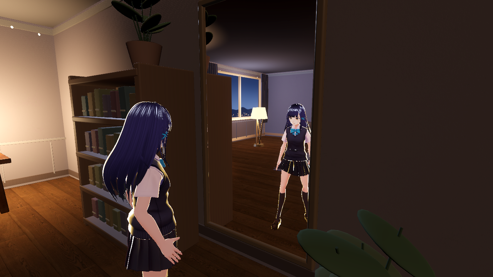
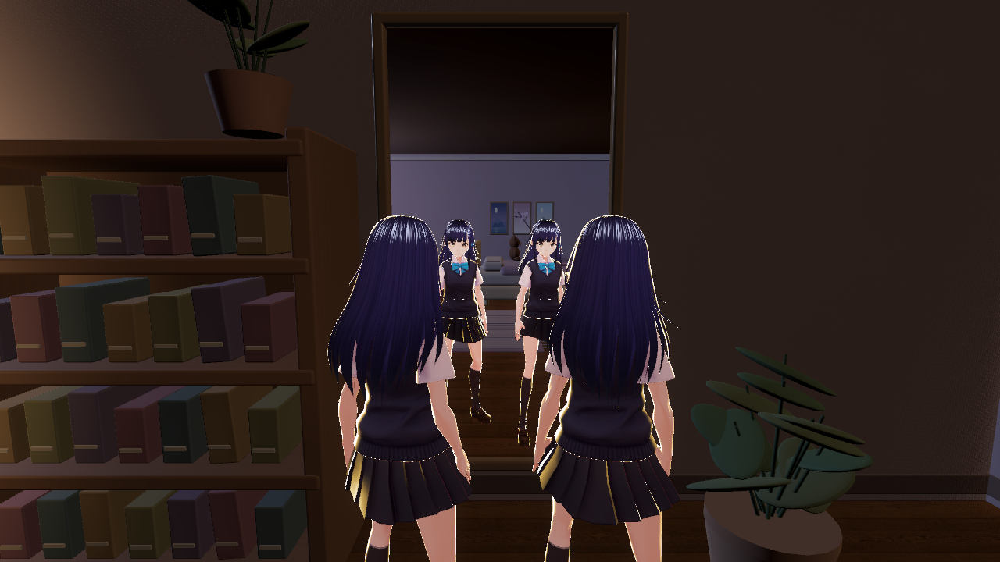

# 卧室质感升级 / bedroom-quality

2026-11-03，分支 friend/bedroom-quality，base为最新 main 9194f8d（已重新fetch核对）。目标为11/5答辩前交付审阅；仅改 art/，Draft PR，由qinglinMa验收合并。客厅、阳台、连续时间和天气暂停；旧 room-spaces WIP保存在本地1207113，未迁入本分支。

## 结果与范围

静态视觉从程序方块升级为CC0沙发、扶手椅、书桌及PBR木地板、灰泥、亚麻；床品/窗帘为原创细分褶皱网格，保持原尺寸。导入3件Poly Haven家具，原始下载27个文件均校验官方MD5及本地SHA256；作者和许可证见 [素材清单](../SOURCES.md)。素材无Booth/VRChat内容，纹理不超过2K。原始贴图不改写，派生变体有可重现生成器。

三套真正烘焙的LightmapGI（day/dusk/night）：206个静态网格全部绑定、3次反弹、Medium/128 rays、UV2约0.07m/texel、每层atlas≤2048。5个显式角色探针叠加自动探针，供站姿、沙发、床沿、椅子和镜前动态角色接收间接光。主光/补光保持实时；床头/落地灯静态直射和反弹烘焙；可开关台灯和灯罩不留下烘焙发光。三套烘焙最后一次分别约5.01s / 3.57s / 3.91s，运行时无需烘焙。

高档提供泛光、SSAO/SSIL、暖调色和柔和窗边体积光；中档为默认，去掉SSIL/体积光。低档保留烘焙GI，关闭镜面/后期/主光实时阴影/法线细节，3D内部比例70%，UI文字不缩放；Mobile自动用低档。移除场景恢复宿主原比例。仅这个美术画质模块控制3D缩放，没有改主线窗口创建。

落地镜用同一个World3D的离轴反射相机，能同时显示两位真实化身，无替身视频/贴图；自身反射层被剔除，避免递归。高/中镜像15/10Hz，离开视野、最小化或关闭时停止更新；低档默认关闭。F8镜面、F7画质、F6时段、L台灯，输入框焦点时不拦截。M保留给原语音控制。声音为本贡献原创CC0合成城市/空调底噪和点击；默认很轻，验收全程禁音频输出，不把合成氛围声称为真实城市录音。

14组Marker的ID、affordances、局部/世界坐标、Seat/Approach与朝向均保持；**Marker调整清单为空**。所有原碰撞和导航算法不改。未修改room.gd、companion、player、bridge、locomotion、VRM/MToon插件、后端或权限。根状态文件按用户只改art/的范围约束保持原样，进度和交接记录在本报告。

## 同机位实际截图

均为Godot 4.6.3实际输出，1280×720、2×MSAA、FOV50、相机(0,1.7,3.65)朝向(0,.95,0)。before来自9194f8d；after为medium。唯一角色来源是仓库已有的CC0千驮谷筱，不提交新增/私人VRM。

| 时段 | 改前 | 改后 |
| --- | --- | --- |
| 夜晚 |  |  |
| 黄昏 |  |  |
| 白天 |  |  |

双人图用两个公开Shino实例分别代表用户和AI；只在离线验收脚本中创建，产品化身仍由主线提供。

## 性能与体积

同机Ryzen9 8940HX / RTX5060 Laptop / Radeon610M。每档240个稳态样本（约4秒），前置预热、2个有Idle动画的CC0角色，镜前/房间两个机位，限制60fps；没有无限帧压测。该测试不启动LLM、ASR、bridge或Electron，不能替代全产品长时间负载验收。CPU/GPU列是主视口渲染耗时P95，非整机占用率，也不单独覆盖镜面子视口；总体FPS包含镜面负载。

| 条件 | 平均FPS | 帧间隔P95 / P99 | 主CPU / GPU P95 |
| --- | --- | --- | --- |
| 独显，Forward+，1280×720，高档、镜面开，产品音频驱动但全部声音禁止播放 | 60.00 | 16.707 / 16.961ms | 1.104 / 2.839ms |
| 集显，Mobile，960×540输出、672×378内部3D，低档、镜面关 | 60.03 | 18.849 / 25.519ms | .900 / 8.079ms |

集显最初全分辨率低档仅28.05fps，改为70%内部比例并简化法线后达上表结果；不隐瞒画质折衷。最终独显Dummy音频驱动对照中，高/中/低平均59.996/59.982/59.920fps，但P95约30ms；主GPU仍只2.78/2.45/.53ms。产品音频驱动静音对照高档P95恢复16.707ms。记录所有测量而非只保留较好结果，Windows驱动/计时环境会影响帧间隔；不把平均60fps说成每一帧都≤16.7ms。原始结构化结果见 [performance.json](quality/performance.json)。建议作者在实际Room组件中再看帧节奏和镜面清晰度。

本次新增源文件/资源/截图约 27.67 MiB（29010712字节，按提交前目录差额计，报告自身有少量误差），低于60MB；无超过2K的源贴图。光照EXR为多层atlas竖向打包，不能把整个容器高度误作单张贴图大小。精确文件SHA和截图SHA见 [evidence.json](quality/evidence.json)。烘焙与截图完成后无残留Godot渲染进程。

## 验证

- scripts/test-local.ps1：1120 Python通过、3跳过；89个Node前端测试文件；Python/JS语法、secrets、映射校验通过。Doctor只提示已有CLI0.163低于0.164，与美术无关，未配置任何Key。
- 首次运行包检查、公开JSON解析和必需Python编译通过。
- Godot既有6组检查（check_navigation、check_player、check_shared_goals、check_room_speech、art/tools/verify、art/tools/check_interaction_contract）退出0；14个接近点连通、43个导航多边形、584次0.30m胶囊检查通过；18个负例验证器通过。
- 新quality_contract随已有Godot CI入口运行：206个绑定×3、5个人物探针、CC0下载SHA、2K上限、时段/画质/缩放恢复、镜面同世界/防递归/开关、台灯灯罩与直射同步、输入焦点保护。
- 27个原始来源SHA和25张≤2K贴图的独立离线校验通过。原始模型/材质只使用官方CC0来源；无联网运行时依赖。

## 已知限制与作者检查

三档灯光切换不是连续昼夜，天气按任务暂停。镜面以分辨率和更新频率换性能，低档需要手动开；尚非VR级立体镜面。材质有照片来源的磨损细节；床/柜/书架仍含原创程序建模，并非全屋DCC重建。环境音仅离线检查循环/波形/增益，未在用户机器播放试听。

离线编辑器烘焙成功后有引擎 list.erase / 编辑场景退出诊断；图形QA退出时仍观察到7个Texture RID清理警告，某些既有目标检查退出时有ObjectDB/PagedAllocator清理诊断。验证退出码0、贴图绑定和真实画面正常；本PR没有修改引擎/行为脚本来掩盖诊断，也不声称已解决这些清理问题。作者实际Windows审阅时请关注反复进出房间的显存释放。

提交仅art/；不含私人配置、Key、模型VRM、导出包、录像或原始日志；无main/force push/自行合并。草稿PR和CI状态另见GitHub Checks，未在报告里提前声称远端通过。安装的可选Room组件仍需作者按主线发布流程更新，本分支不替换用户桌面安装。

## 交接

当前代码、三套烘焙、截图、素材许可、本地验证完成。下一步：普通推送friend/bedroom-quality到origin，创建base=main的Draft PR，确认Linux/Windows及Godot CI；作者Windows审阅/决定合并。继续工作先读本报告和art/README.md；不要恢复客厅/阳台/天气，不要修改Marker或角色脚本。重生成静态资源必须同时重烘焙三套，步骤见README。
