# 卧室美术打磨验收

[草稿PR #241](https://github.com/MaQinglin-665/AI-chat/pull/241)。基线：`9368749`（含 #240），目标 `codex/godot-room-spike`，分支 `friend/godot-room-art-polish`。2026-11-01，同一台 Windows 电脑、Godot 4.6.3。只改 `godot_room/art/`，本目录保存状态与交接，遵守用户范围限制，不改根状态文件。

## 改动和边界

- 地板使用独立哑光材质：SPECULAR=0、ROUGHNESS=0.90。其他木材仍为0.5/0.62；所有灯光、衰减、预设和角色照明原值不变。
- 城市窗景：三层圆形光核、大小/亮度变化、柔和光晕与少量冷色灯；不闪烁、不依赖TIME。抗锯齿使用连续UV导数，避免哈希分格边界出现竖向亮线。
- 两幅后墙画、三幅侧墙画换成原创月夜山水、樱花枝、暮色山水程序画，保留画框、碰撞、交互和位置。
- 窗台、书架顶各加一盆中型植物；床上加原创睡熊玩偶；桌面加无品牌杯子、茶水、笔记本和笔。原可拿书本不变。
- 新小物仅为家具表面的非交互视觉装饰，沿用家具简化碰撞；不新增地面障碍、拾取/坐下能力或Marker，精细叶片/杯把不单独参与物理。
- 不改room.gd、角色行为、导航参数、VRM插件、模型、后端或私人配置。

## 地板发白的根因

地板整体共用同一块a77b58木纹，并非左右不同材质。固定夜间机位控制实验：只去掉地板高光，右侧恢复暖木色；只关闭局部暖灯，右侧仍发灰。默认SPECULAR=0.5在冷色方向补光下形成宽高光，是去色主因。暖灯衰减影响左侧明暗，但不是右侧发白根因。

| 原材质/原灯光 | 只关闭地板高光 | 只关闭局部灯 |
| --- | --- | --- |
| 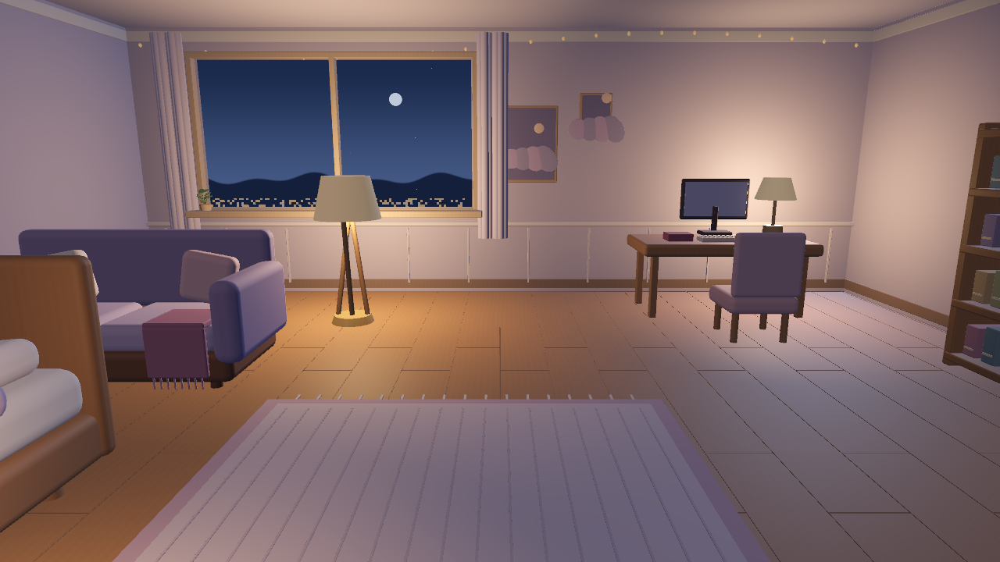 | 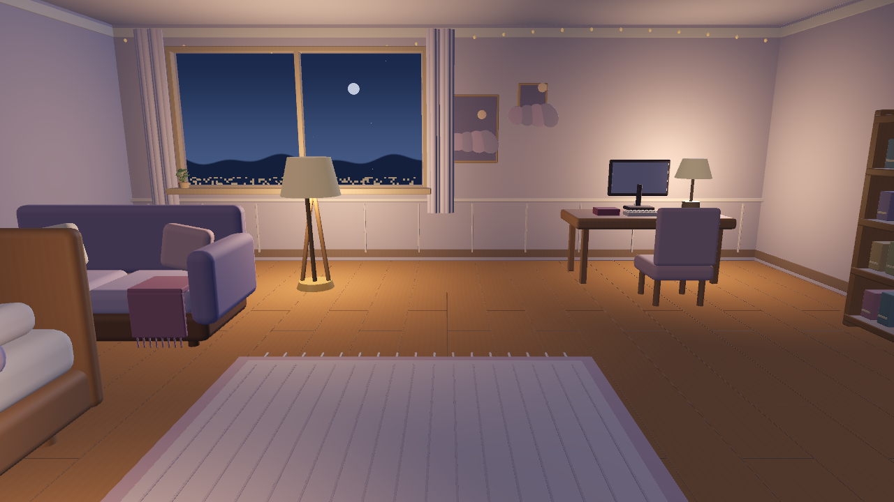 | 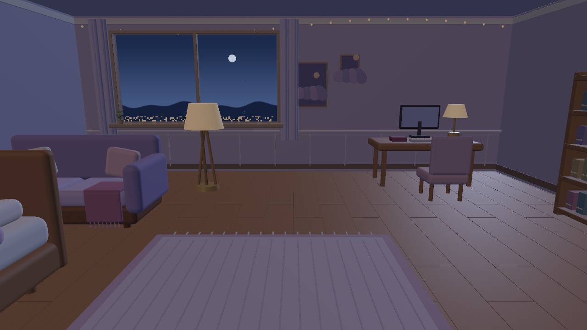 |

固定20×17像素采样框（避开人物和接缝）：左(475,444)-(495,461)，右(1110,444)-(1130,461)。原夜间右侧平均RGB约152/129/135，R/B=1.12；无高光约121/77/51，R/B=2.39；只关闭局部灯仍约122/116/131，R/B=0.93。最终夜间右侧/左侧R/B=2.40/2.63，白天1.96/2.02，黄昏2.51/2.59。保留自然亮暗差，消除右侧白紫色高光。

## 三套灯光同机位前后

1280×720、2×MSAA、FOV50，摄像机(0,1.7,3.65)看向(0,.95,0)，与#238机位一致。只使用已有公开CC0千驮谷筱。全部为实际引擎截图；before在修改产品代码前保存，after使用最终代码。角色Idle自然改变姿态，摄像机、灯光、模型和角色位置相同。保留首次接入的旧截图。

| 预设 | 改前 | 改后 |
| --- | --- | --- |
| day | 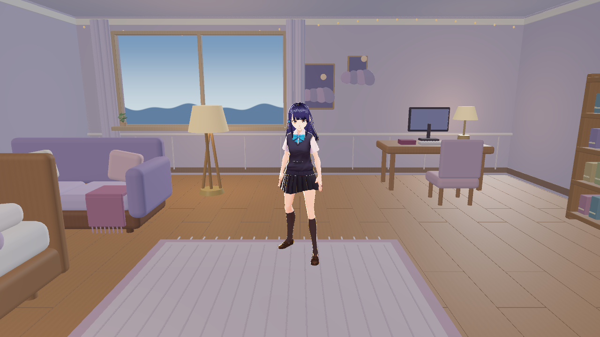 | 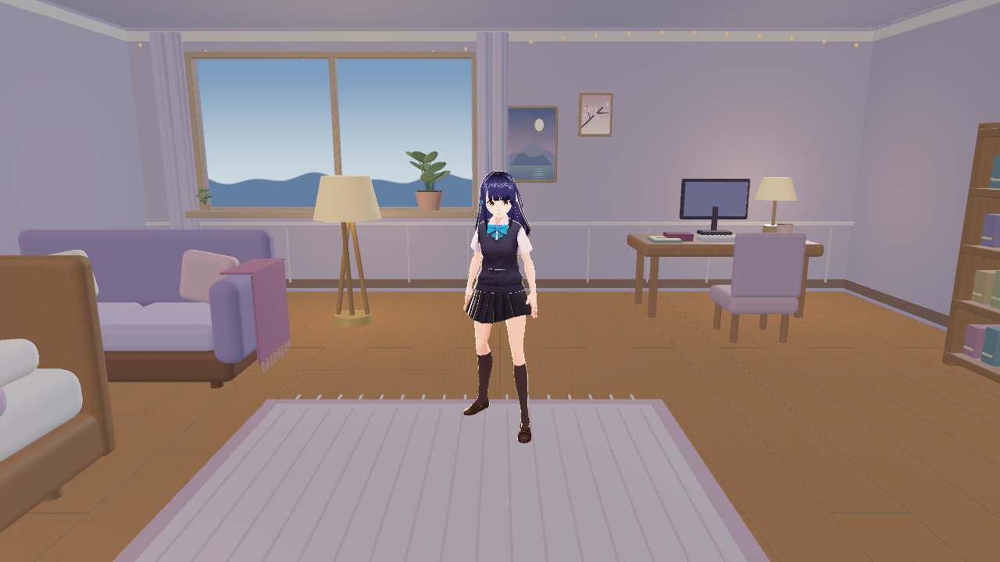 |
| dusk | 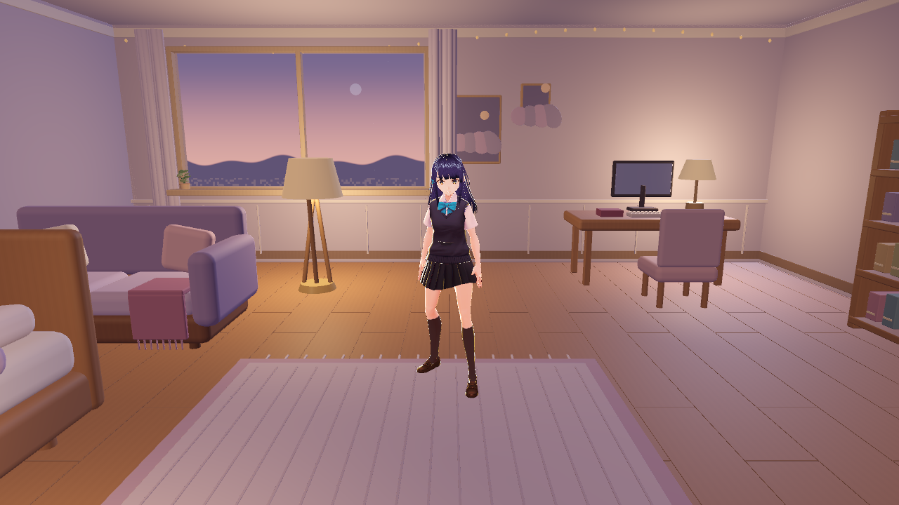 | 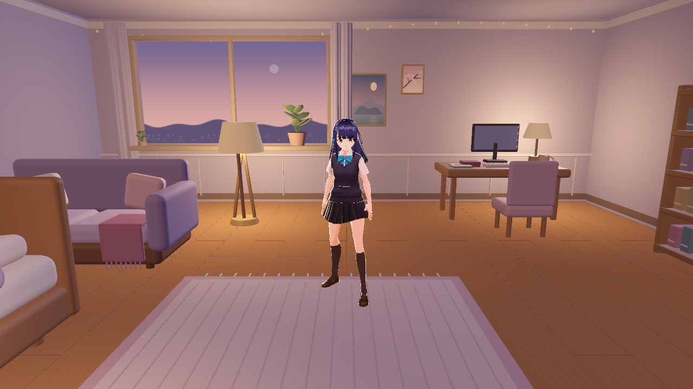 |
| night | 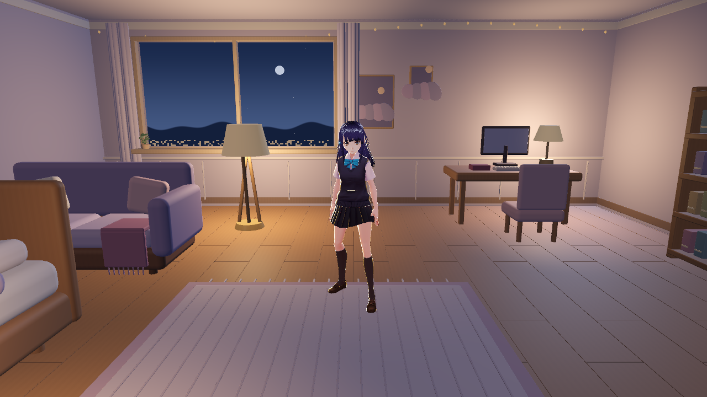 | 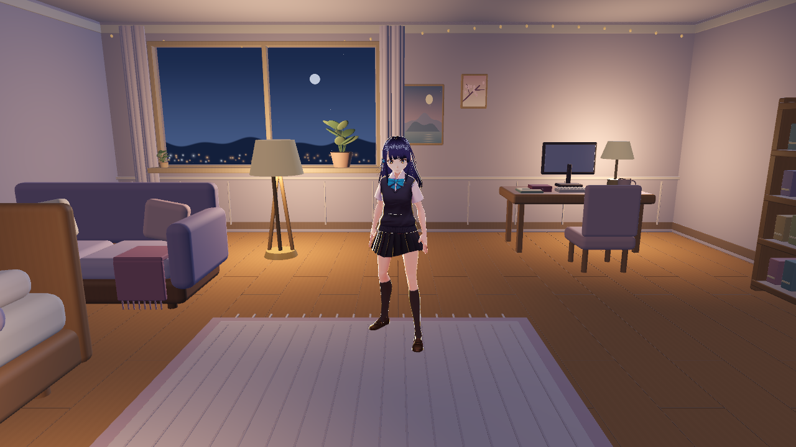 |

| 全景前 | 全景后 |
| --- | --- |
| 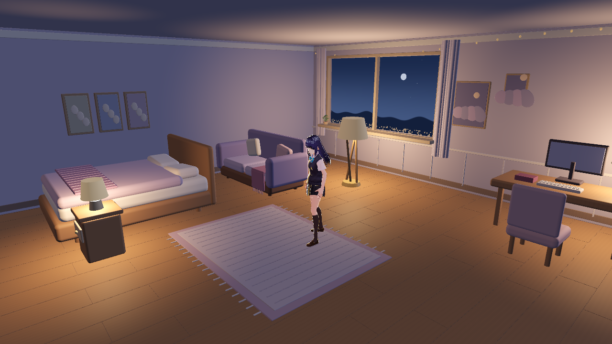 | 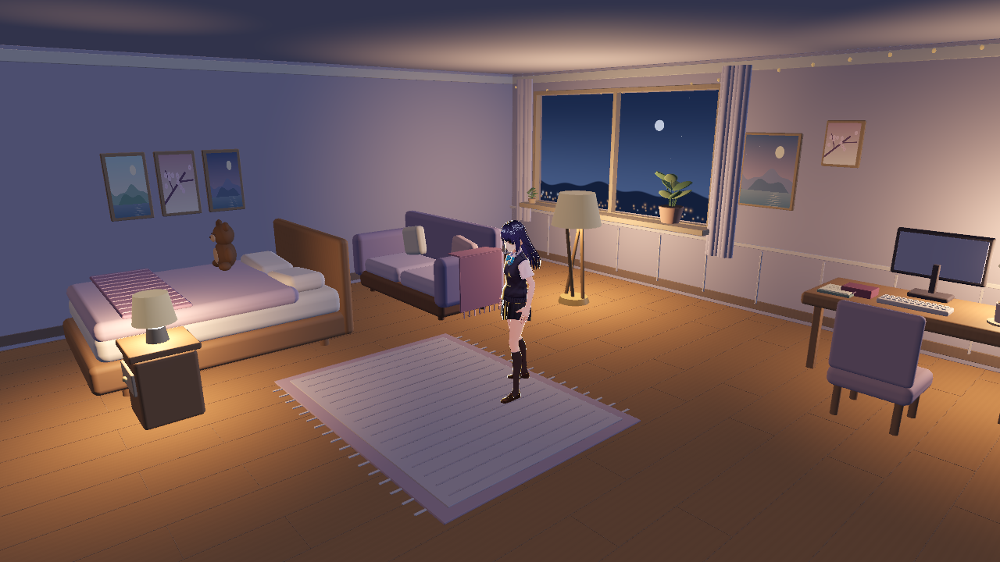 |

| 窗景和中型植物 | 书架植物/桌面小物 | 玩偶和侧墙画 |
| --- | --- | --- |
| 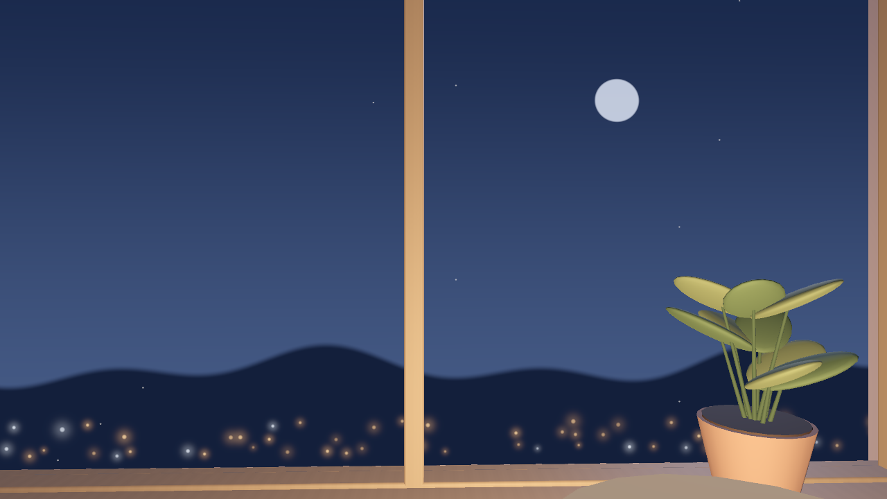 | 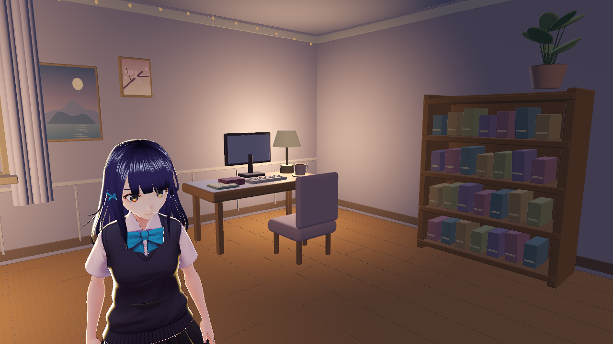 | 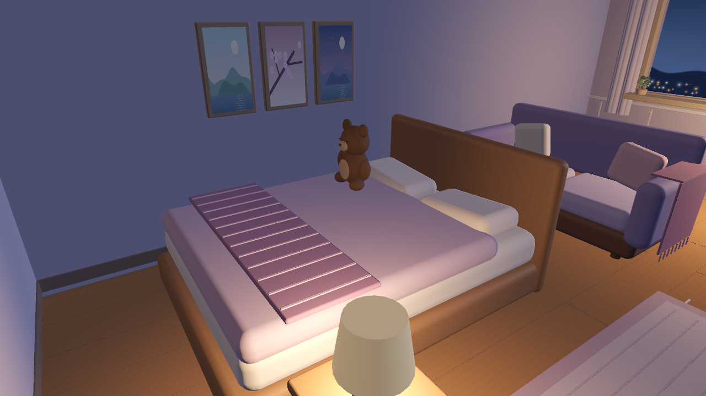 |

## 交互和导航验证

`tools/fixtures/interaction-contract.json`在9368749修改前从真实场景记录，冻结不自动更新。`tools/interaction_contract.gd`采集14个原交互物体/Marker的全部metadata、局部/全局位置和旋转、缩放、Approach和Seat子节点。`tools/verify.gd`严格比较：**所有ID、affordances、落座点、朝向和接近点零改动，无需列出前后值。**

导航仍为43个多边形，14个接近点从入口连通；584次半径0.30m、高1.65m的胶囊路径采样全部无碰撞。原家具碰撞不变。首次试验新增盆栽包围碰撞压缩窗边净空，已撤销；最终不新增物理节点。

本地命令（引擎放仓库外）：

```text
godot --headless --path godot_room --script res://art/tools/verify.gd
godot --headless --path godot_room --script res://check_navigation.gd
godot --headless --path godot_room --script res://check_shared_goals.gd
godot --path godot_room --position -16000,-16000 --max-fps 30 --script res://art/tools/capture_polish.gd -- after
```

主线行为检查清空测试进程的TAFFY_API_TOKEN，不连接后端。截图脚本只创建美术场景、公开模型和已有动画，不创建player/bridge，不发声。新截图和诊断脚本默认30fps；诊断输出user://，不覆盖冻结证据。capture_polish拒绝before参数，避免误用新场景覆盖改前图。

## 同机性能（使用已完成短测，不重复跑分）

Ryzen9 8940HX/32逻辑线程、RTX5060 Laptop、Radeon610M。同机位、单个公开Shino+Idle，无桥接/LLM；预热240帧，各采样12秒。以下为此前不限帧时已采集的数据；用户反馈影响桌面操作后已停止该测试方式，后续图形检查限30fps。表中不是限帧运行FPS，也不代表完整双角色自主行为性能。

| GPU/配置 | 平均FPS 前→后 | P95帧时ms 前→后 | 渲染GPU ms 前→后 | 进程CPU% 前→后 |
| --- | --- | --- | --- | --- |
| RTX5060 / Forward+ / balanced 1280×720 2×MSAA | 676.5 → 701.7 | 1.987 → 1.874 | 1.275 → 1.241 | 2.88 → 3.09 |
| Radeon610M / Mobile / balanced 1280×720 2×MSAA | 87.7 → 100.6 | 12.261 → 10.759 | 10.662 → 9.239 | 0.83 → 0.83 |
| Radeon610M / Mobile / low 960×540 无MSAA | 165.3 → 222.4 | 6.93 → 4.993 | 3.841 → 3.984 | 0.8 → 1.22 |

CPU为实际Godot子进程CPU时间/墙钟时间/32线程，非console启动器；GPU为引擎viewport计时。单轮短测受笔记本功耗、调度、温度和背景负载影响，**不能据此宣称提速**；low GPU耗时仍由3.841升至3.984ms。Forward+三角形300540→317650、draw calls348→383，新增小物确有开销；三档显存各约增0.13MiB。未见帧率回退，不保证其他机器60fps。需完整应用长测时另征用户同意。

## 体积、来源、限制

新增运行贴图0张、外部依赖0个。运行美术源文件约增8.5KiB；含14张PNG、冻结契约等，art/约3.81→9.74MiB，增约5.93MiB，低于30MB预算。按文件长度估算，非git压缩增量。无模型、引擎、导出包、录像、日志或原始采样提交。

所有新增几何/绘画为本PR原创程序内容、AI辅助，按本模块CC0声明提供；无参考图像素。见[素材清单](../SOURCES.md)。公开Shino仅沿用spike现有CC0模型。小物不支持拾取，叶片不单独碰撞；作者需在主线房间检查实际行走和观感，由作者决定合并。

## Verification Evidence / 当前交接

- 已通过原始基线verify、最终场景图形编译和实际截图检查；最终交互契约严格一致、43多边形、14路线、584胶囊采样。
- 完整scripts/test-local.ps1通过：1111个Python通过、3跳过；全部86个Node测试文件通过；202个Python/271个JS语法检查通过；公开JSON和所需py_compile通过。新增文件暂存后secret scan通过（928文件），diff检查通过。
- Godot4.6.3本地最终verify通过；check_navigation通过（位移3.389m、Sitting_Idle后起身Idle）；check_shared_goals通过（沙发入座、占用拒绝、用户打断和utility目标不抢占）。
- GitHub Linux/Windows等检查以草稿PR最新head的Checks为准；该CI不运行Godot引擎，以上Godot证据为本机实际运行。PR保持Draft，base为codex/godot-room-spike，由作者验收合并。

## 证据图SHA256

- `after-bed.png`：`29288dc6142f1980219a303835f94d86028ee5da896f44121add8bee7b596215`
- `after-day.png`：`a672ecf3c90b42881c3b1e6842dcf7b482310c8e5de77c65e90b1a0f1d6f05fe`
- `after-desk.png`：`66070b736c94b9f6a4015a8b0961c99b9aaed66ddb2a2453726b66f1ad0c6b1d`
- `after-dusk.png`：`dab14b9a6b5f78bb4d1647c323ccc0dbcab6ee29384b0396a29cfbf64946a221`
- `after-night.png`：`32c717cc3b575ce2c77d1e3dd678577e6563b6d044cca53a5913b6f4225d793f`
- `after-wide.png`：`2a350b5b0f88240d66111410d0ef66674425ade577067ad87f9d4b33da71a6f9`
- `after-window.png`：`145286a82afc806a5d780a4c81d3d3eefead1339611c9fa343feac0955912398`
- `before-day.png`：`062341fe8198acadf0b62c69adfb78b563a253b9544d8fc0414b3edbedbb10bb`
- `before-dusk.png`：`6bbfe09237e71cf5aa7683c1556555b2a55ef1db6ae425e933d30840572aae9e`
- `before-night.png`：`0016959862ecb66fd23fc758b76f953877146cb0c989732f81f445e18a7def62`
- `before-wide.png`：`ab6c4291aa9f3f0593af73ec4a51162e69970cc78ba365a80d89b34ab869385e`
- `diagnostic-no-practicals.png`：`2e81a6c3ffd59ec63d1750fb992eb1f5323bde5598cf592f1e8805d3a08bca69`
- `diagnostic-no-specular.png`：`36c4bfbb2082c32e6cea80fcf523a56dc19ddb0ca46c97c5b6df622c4ebd93d1`
- `diagnostic-original.png`：`e61f9b51813a99d6567fd4e0de384e1d11bbb172c9fb2abe7bc0b9a355dee537`
