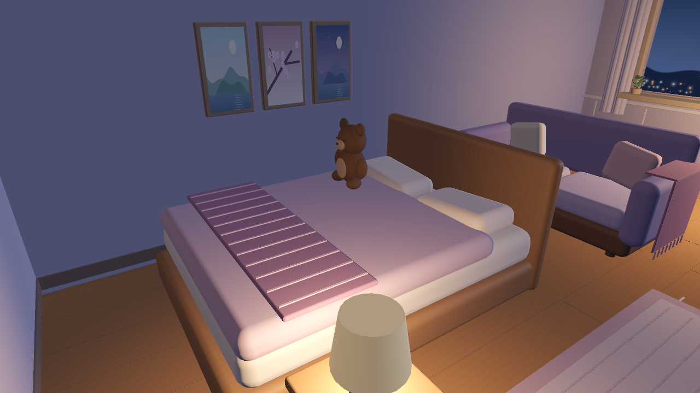
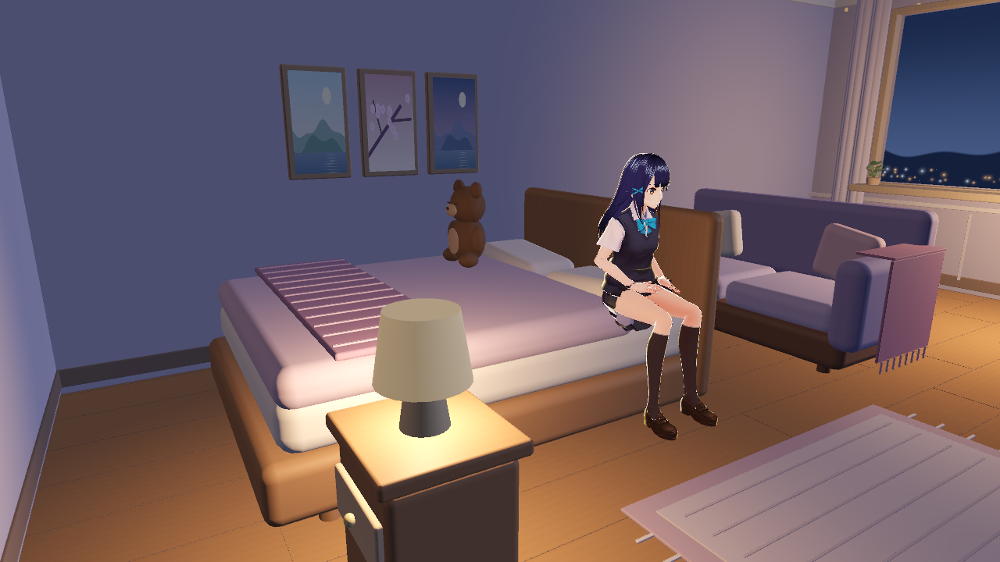
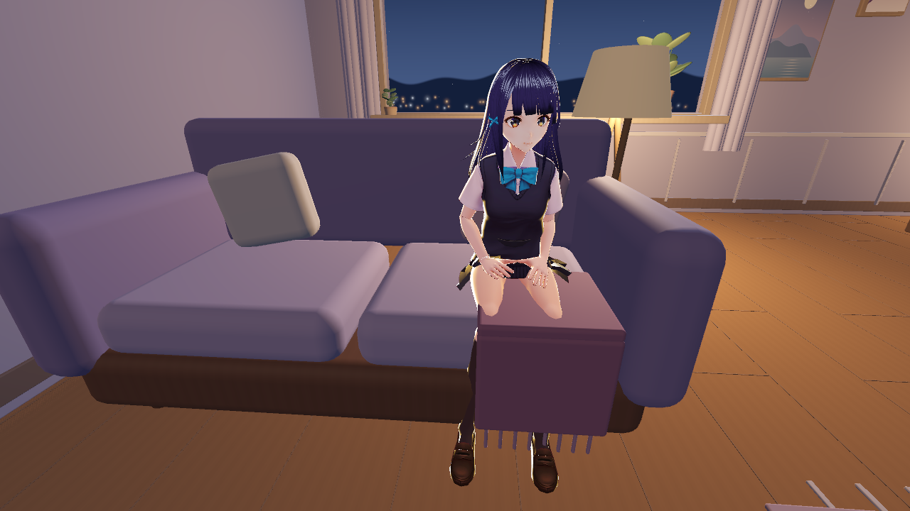
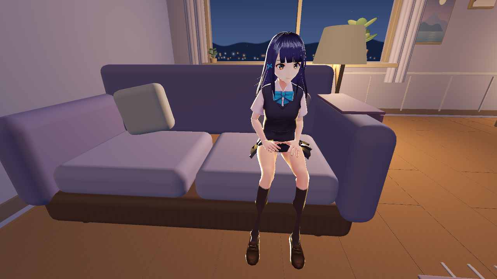
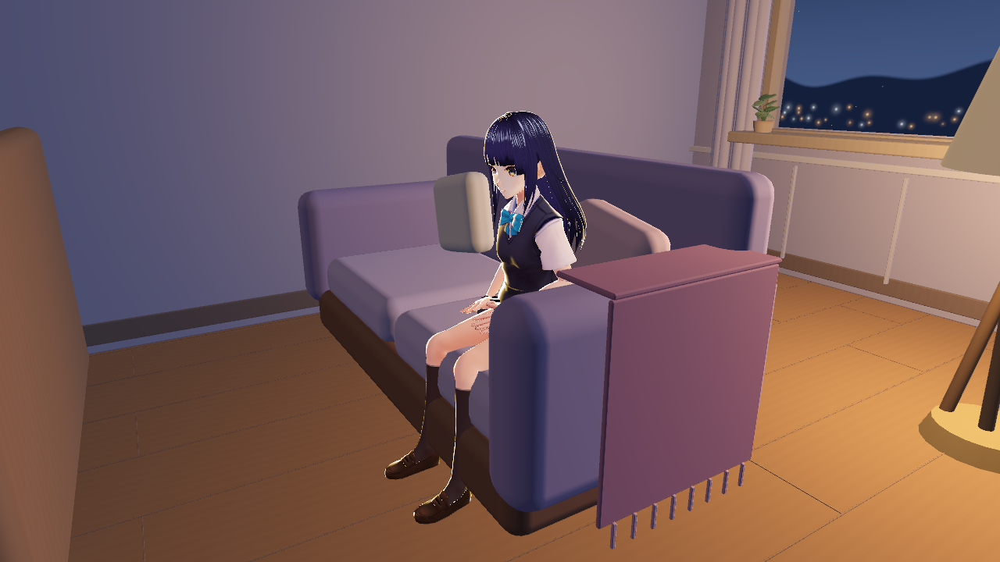

# PR241 合并前修订

仅art/，已普通merge作者最新5e10022；不改主线行为、后端、模型或私人配置。所有截图仅公开CC0千驮谷筱、离线静音，30fps上限，无新跑分。

## 1. 原创棕色泰迪

毛皮改棕色805b43，浅棕口鼻和腹部c5a187、深棕五官，删除上衣/围领。无黄色加红上衣组合，无角色标识；仍为本模块原创CC0程序几何。



## 2. 床沿坐点metadata

原14个交互点包含bed。沿用bed ID，只增加sit能力和Seat子Marker；总交互点仍14，新增Seat不是新的物件ID。其余13个交互点及bed原Approach严格保持原值。

| 项目 | 原值 | 新值 |
| --- | --- | --- |
| 交互ID | bed | bed（不变） |
| body / Interaction affordances | ["look"] | ["look","sit"] |
| Interaction approach | NodePath("Approach") | 不变 |
| approach_position（局部m） | (1.65,-0.38,-0.5) | 不变 |
| Approach世界位置m | (-1.40,0,1.32) | 不变 |
| Interaction seat | 无 | NodePath("Seat") |
| seat_position（局部m） | 无 | (0.82,0.375,-0.20) |
| seat_yaw（弧度） | 无 | π/2 ≈ 1.570796327，面向房间+X |
| 新增子Marker路径 | 无 | WalkableRoom/bed/Interaction/Seat |
| 新Seat metadata.id | 无 | bed_edge_seat |
| 新Seat metadata.affordances | 无 | ["sit"] |
| Seat世界位置m | 无 | (-2.23,0.755,1.62) |

body/Interaction的位置、旋转、缩放、原碰撞和其他metadata不变。Seat是坐面接触点，并非角色根节点高度。已有room.seat_for按1/4宽度分配共享座位；截图复用Companion侧偏移，床宽1.85m，沿座位本地X偏0.4625m，最终接触点约(-2.23,0.755,1.1575)，没有改主线算法。

原始interaction-contract.json **没有更新/覆盖**。validate只归一化获准的bed能力和Seat新增字段，再严格比较整个原快照。独立check_interaction_contract.gd包含18反例：14个ID逐一变更、bed/sofa的Approach和Seat各偏移1mm都必须失败，恢复后通过。

verify仍为43个导航多边形、14个接近点连通、584个0.30m胶囊采样无碰撞。没有新增导航障碍。



集成边界：物理交互可读取新sit/Seat；后端app_room_spike.LABELS仍把bed列为look，本PR不改后端白名单。自然语言让AI坐床需主线另行接入/验收，不把这张图宣称为LLM已调用成功。

## 3. 沙发右侧搭毯

原搭毯在右坐垫前缘遮腿。改成扶手外侧：上折边中心(1.045,.602,-.08)、大小(.25,.018,.68)；外垂面中心(1.155,.24,-.08)、大小(.018,.70,.68)；流苏在外侧。沙发Marker、碰撞、座位和共享宽度不变。

Shino位于room.seat_for的Companion右坐垫位置：原Seat沿本地X偏2.30/4，世界(-2.425,.50,-.92)。沿用Sitting_Idle和已有髋部对齐，不生成player/bridge或载入其他模型。

| 旧搭毯参数复原控制图 | 修订后实际截图 |
| --- | --- |
|  |  |

控制图只在隔离验收场景复原e3013b0的搭毯尺寸/位置，其余条件相同，**不是旧完整房间版本截图**。同机位能看到旧参数遮腿、修订后双腿双脚完整。侧面复核：



沿当前姿势的左右LowerLeg→Foot各采33点，计算到可见搭毯世界AABB的距离减6cm包络。旧参数最小裕量-0.06m，修订后+0.381m；after非正或非有限时验收退出失败。此检查仅验证这套坐姿小腿区域，配合两个角度实际截图，不声称覆盖所有角色/动作。

## 验证命令和结果

```text
godot --headless --max-fps 30 --path godot_room --script res://art/tools/verify.gd
godot --headless --max-fps 30 --path godot_room --script res://art/tools/check_interaction_contract.gd
godot --path godot_room --position -16000,-16000 --max-fps 30 --script res://art/tools/capture_review.gd -- before
godot --path godot_room --position -16000,-16000 --max-fps 30 --script res://art/tools/capture_review.gd -- after
```

Godot4.6.3的verify、独立contract、18反例、实际坐姿间距检查均通过。完整scripts/test-local.ps1通过：1118 Python/3跳过、87 Node文件、202 Python/273 JS语法检查；最终CI以PR最新head Checks为准。7张after已刷新，新加4张审核图；原始before/诊断图不动。不提交模型、导出包、录像、日志。本次没有重跑不限帧测试，初版性能表仅为初版polish数据。

## 审核图SHA256

- review-after-bed-seat.png: `a63aedc358e3896c71f48baac90a86aa11f020f3d080a58817a1aa36b63677af`
- review-after-sofa-right-angle.png: `0754ff8a01ff6a64082cedc2b21cf2b1f8b3384e5c5cab1c8a2d5c5076371c33`
- review-after-sofa-right.png: `fdbe0b78d0ab1db2468ede5f022bf388f260ad459d8e7146cdfa37e03228da70`
- review-before-sofa-right.png: `2361f5b90bd2b8fc565971351a8e8cb5d8bf22a493b3ce9386c22d7bc19a236f`
