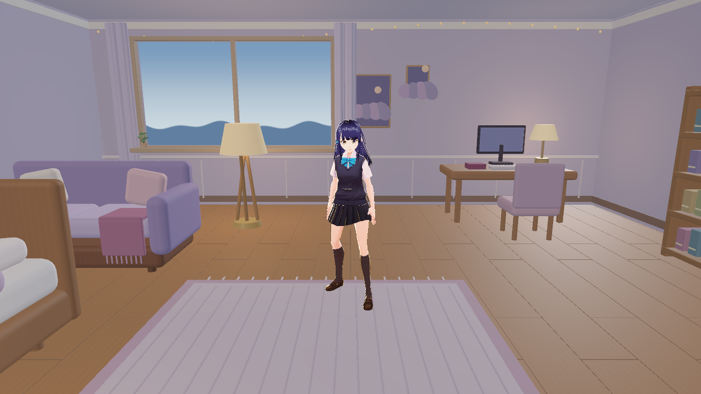
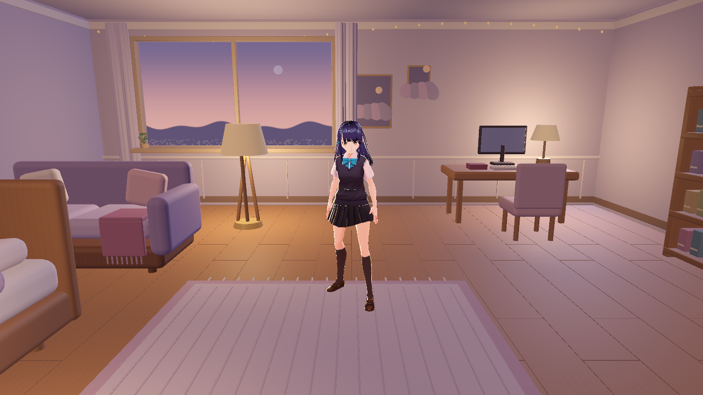
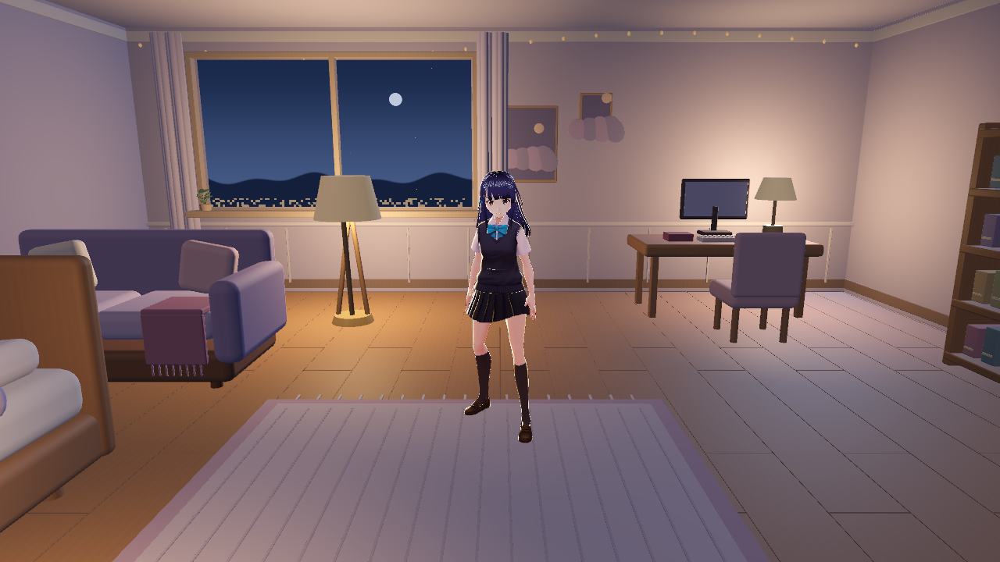
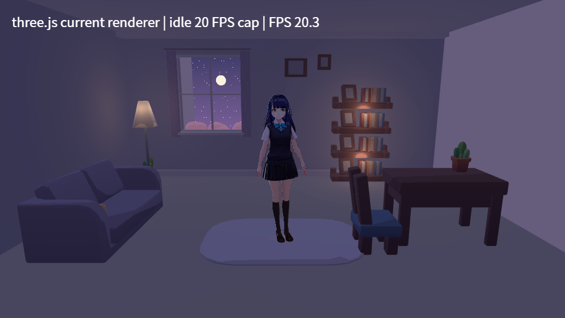
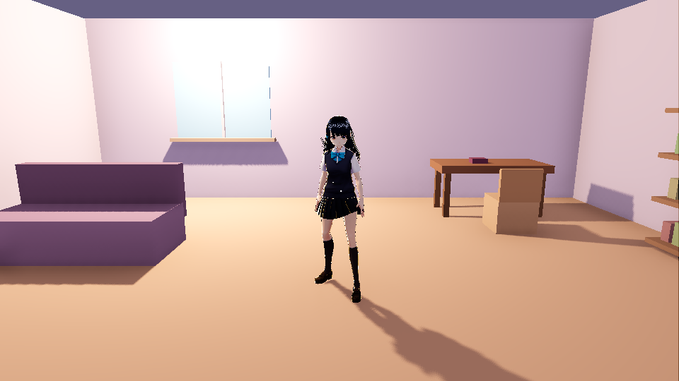
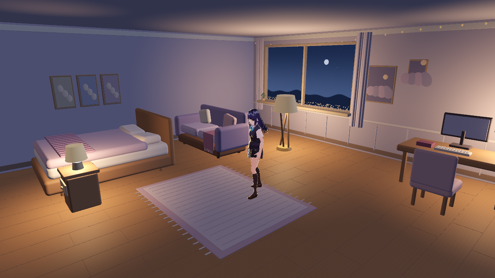
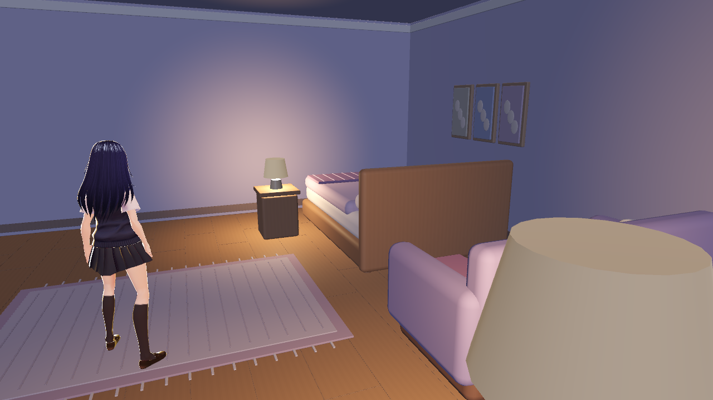
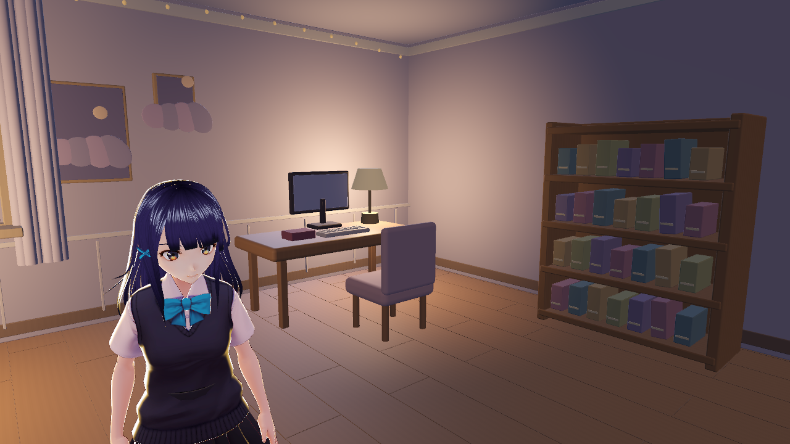
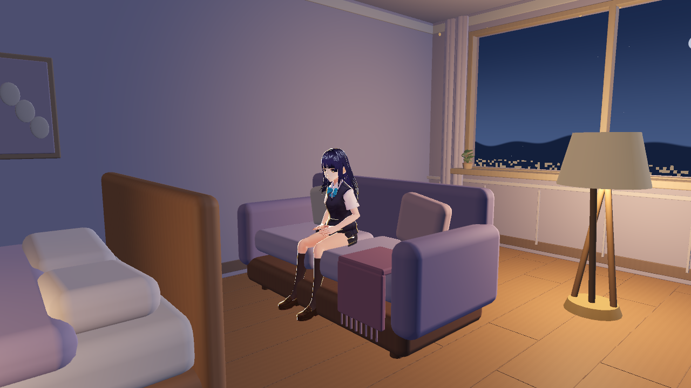
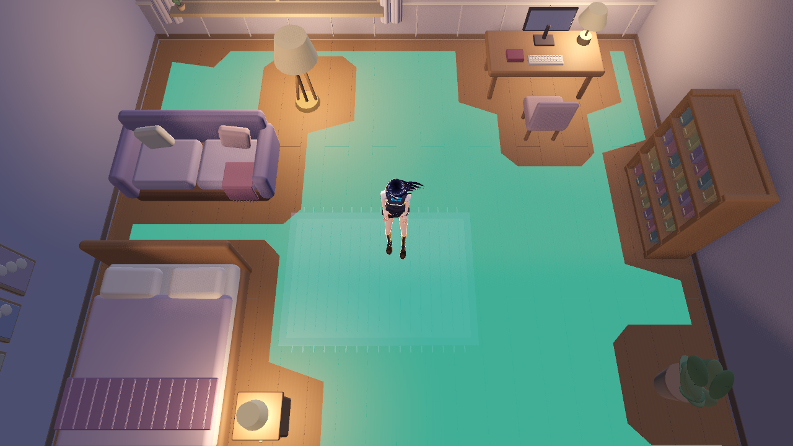

# 实际引擎截图与同机位对照

2026-11-01，Godot4.6.3 / Forward+ / 1280×720 / 2×MSAA。均为真实引擎原始截图，无AI补绘/后处理，仅使用spike已有CC0千驮谷筱；不读取私人模型或配置。场景、材质和灯光为本PR原创程序美术。参考背景图未作为贴图。

## 三套光照：固定相机

相机(0,1.7,3.65)，目标(0,0.95,0)，垂直FOV50°；与#238的three.js/Godot对照机位完全相同。新图1280×720，原图960×540，宽高比一致；比较的是不同布景，不能当作相同材质的渲染器精度对比。

| day | dusk | night |
| --- | --- | --- |
|  |  |  |

| #238 three.js | #238原Godot方块房间 | 本PR夜间美术 |
| --- | --- | --- |
|  |  |  |

窗面改为夜蓝天空/山脊/城市光点的低亮原创着色器，人物由主光+前补光照亮，暖点光只补局部。三套环境保留卡通角色；具体观感请qinglinMa检查。

## 家具、坐姿与导航

| 内容 | 实际截图 |
| --- | --- |
| 室内广角/角色站立 |  |
| 床、布艺和左墙装饰 |  |
| 书桌椅、书架与植物 |  |
| 千驮谷筱在沙发上 |  |
| 实际烘焙导航网格（仅此图隐藏视觉顶面，碰撞不改） |  |

绿色半透明区域直接来自NavigationMesh顶点/多边形，不是示意图。床/沙发顶面孤岛已排除。坐姿截图在离线验收脚本中用原动画和Seat标记对齐髋部，**没有修改主线自动入座逻辑**。主线接入Marker后仍需按角色身高调校坐面接触和起身。

## 文件摘要

| 图片 | 字节数 | SHA256 |
| --- | ---: | --- |
| [01-comparison-day.png](01-comparison-day.png) | 385905 | `b11d217e15359681794b98112d9bc9262e5c816d8b15ef06929f7ed4b5508d40` |
| [01-comparison-dusk.png](01-comparison-dusk.png) | 488119 | `b516be81cc3bdd0c3d972f0a013cf53bb572db0930270eedbb245b98a0da4e01` |
| [01-comparison-night.png](01-comparison-night.png) | 512725 | `81ac803c46d22a0202a35711e72e29047b985223ac1cddec12eeae031b8085b8` |
| [02-room-wide-night.png](02-room-wide-night.png) | 530996 | `ccfcdf642587e65bf143049c92ff9002dfd9a19e10ca4b37b3542c0adc8fe7ce` |
| [03-bed-and-textiles.png](03-bed-and-textiles.png) | 334622 | `27162283a08c611e5b923fdd5fb31d8822df6688de5782d62926ecc3d2b12144` |
| [04-desk-and-shelf.png](04-desk-and-shelf.png) | 560682 | `d29de6f6a53c097dac7991cd49430ad8462c898bd60d84b64a65de7dec4b2c14` |
| [05-shino-sofa-night.png](05-shino-sofa-night.png) | 380387 | `0979b20ff0c6f8a33dbf8171652c0e13cbc10a71678c2cc09fe3d7a10657b062` |
| [06-baked-navigation.png](06-baked-navigation.png) | 757926 | `5872a6214d6b03c5aebf6f5003a2a7054d5cb4854766839d0e7fa1cfb3c3d82f` |
